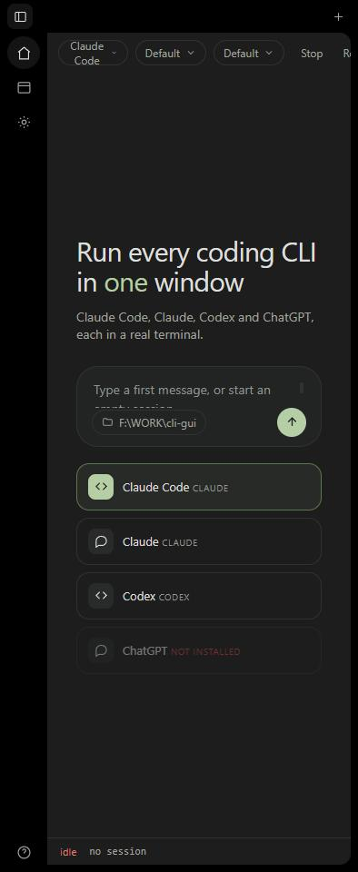

<p align="center">
  
</p>

<p align="center">
  A desktop-style window for the Claude and OpenAI coding CLIs, with a UI modeled on Freebuff.
</p>

---

ezCLI is not a harness. Each session spawns the real CLI in a real pseudo-terminal, so
the agent's own text UI renders unchanged. Nothing is proxied, re-prompted, or rewritten.
The window adds the parts a bare terminal lacks: tabs, an agent switcher, a file and diff
browser, and model and mode flags you pick before launch.



## Install

The Windows installer lives on the [Releases page](https://github.com/Aryansingh0783/ezCLI/releases).
Grab the latest `ezCLI_x.y.z_x64_en-US.msi`, double-click, done. The window opens with
the agent CLIs already resolved from PATH.

The app writes its editable config to `~/.ezcli/agents.json` on first run.

## Build from source

ezCLI is a Rust desktop app built with Tauri 2 and a vanilla HTML/CSS/JS frontend.

Prerequisites:

- Rust (stable, 2021 edition). On Windows the GNU toolchain works without MSVC Build Tools:
  `rustup toolchain install stable-gnu && rustup default stable-gnu`.
- The Tauri CLI: `cargo install tauri-cli --version "^2.0"`, or download the prebuilt
  binary from the [Tauri releases](https://github.com/tauri-apps/tauri/releases).
- WebView2 Runtime (shipped with Windows 11; Windows 10 users get the Evergreen bootstrapper).
- `git` on PATH, if you want the Changes pane.

Then:

```bash
git clone https://github.com/Aryansingh0783/ezCLI.git
cd ezCLI
cargo tauri dev        # live window, Rust hot-reload on save
cargo tauri build      # produces src-tauri/target/release/bundle/msi/ezCLI_1.0.0_x64_en-US.msi
```

## What it does

| Area | Behaviour |
| --- | --- |
| Session tabs | One pseudo-terminal per tab. A colored dot shows running, exited, or failed. |
| Agent switcher | Claude Code, Claude, Codex and ChatGPT. A CLI that is not on PATH shows as disabled instead of failing on launch. |
| Model and mode chips | Map to real CLI flags from `agents.json`. You set them before launch; a running session locks them until you restart. |
| Terminal | xterm.js with the Freebuff dark palette and JetBrains Mono. Full color, cursor, and live resize. |
| Files pane | Browse the session folder and preview any text file, up to 256 KB. |
| Changes pane | Branch, working-tree status, and a colored diff for each changed file, straight from `git`. |
| Composer | A text box that writes to the process, with `Ctrl+C` and `Esc` buttons for the agent's own prompts. |
| Status bar | State, the resolved command line, the working directory, and the terminal size. |

Full operating instructions are in [GUIDE.md](GUIDE.md).

## Keyboard

The window claims only `Ctrl+Alt` combinations, so the agent's own terminal shortcuts
(`Ctrl+C`, `Ctrl+W`, `Ctrl+R`, and the rest) always reach the CLI.

| Keys | Action |
| --- | --- |
| `Ctrl+Alt+N` | New session |
| `Ctrl+Alt+W` | Close session |
| `Ctrl+Alt+B` | Show or hide the sidebar |
| `Ctrl+Alt+K` | Clear the terminal |
| `Ctrl+Alt+1` … `9` | Jump to a session |
| `Enter` | Send the composer |
| `Shift+Enter` | New line in the composer |

## Configuring agents

`agents.json` lists every launchable CLI. Each entry gives a `command` resolved on PATH,
plus `modes` and `models` whose `args` are appended to the launch line. Edit the file,
then choose "Reload agents.json" from the gear menu. No restart needed.

```json
{
  "id": "claude-code",
  "label": "Claude Code",
  "command": "claude",
  "modes": [
    { "id": "plan", "label": "Plan", "args": ["--permission-mode", "plan"] }
  ],
  "models": [
    { "id": "opus", "label": "Opus", "args": ["--model", "opus"] }
  ]
}
```

Detected on a typical setup:

- Claude Code, from `claude`
- Claude, from `claude`
- Codex, from `codex --no-daemon`
- ChatGPT, disabled until a `chatgpt` binary is on PATH

### Why Codex passes `--no-daemon`

Codex normally detaches a background server. When ezCLI runs inside a Windows job object
that forbids breakaway, that detach fails and Codex exits at once. The flag keeps Codex in
the foreground. Remove it from `agents.json` if your setup does not need it.

## How it works

```
src-tauri/
  Cargo.toml            manifest, release profile, dependencies (tauri, portable-pty, …)
  tauri.conf.json       window geometry, bundle targets, icons
  capabilities/         Tauri 2 permission ACL
  src/
    main.rs             tiny entry point
    lib.rs              Tauri command handlers wiring the modules below
    agents.rs           agents.json parsing, PATH + PATHEXT resolution
    pty_mgr.rs          portable-pty session store, reader + wait threads, resize + kill
    files_api.rs        directory listing, 256KB text preview, binary heuristic
    git_api.rs          git status / diff via std::process
  icons/                generated from docs/icon.png

public/                 the frontend, served from inside the Tauri window
  index.html            window markup
  styles.css            Freebuff design tokens and components
  app.js                calls backend via window.__TAURI__.core.invoke
                        + window.__TAURI__.event.listen
  vendor/               xterm.js + addons, vendored (no bundler)

agents.json             shipped default; copied to ~/.ezcli/agents.json on first run
```

When you start a session, the Rust side spawns the CLI with `portable-pty`, keeps the
PTY master, and runs two threads: one pumps every byte the child writes to the frontend
as a `pty-data:<id>` event, one waits for the child and emits a single `pty-exit:<id>`.
Launch arguments only ever come from `agents.json`, never from JavaScript.

ezCLI makes zero model calls of its own. The agent CLIs do all the talking to Anthropic
or OpenAI, exactly as they would in your shell, so running the window costs nothing
beyond what the CLIs already use.

The browser opens one WebSocket per session to `/pty`. The server resolves the command on
PATH (walking `PATHEXT` on Windows, where an npm CLI is usually a `.cmd` shim), spawns it
with `@lydell/node-pty`, and streams bytes both ways. Launch arguments come only from
`agents.json`, never from the page, and the WebSocket upgrade is refused unless the request
originates from loopback on the server's own port.

## Requirements

- Node.js 18 or newer
- `git` on PATH, for the Changes pane
- At least one of the agent CLIs installed

## Design source

Colors, radii, type scale, and spacing come from the live Freebuff dark shell and sit as
tokens at the top of `public/styles.css`: background `#000`, sidebar `#1c1d1c`, border
`#2f322f`, text `#dedfdd`, brand `#b5cea5`. The frontend passes the Impeccable design
detector with no findings.

## License

MIT. See [LICENSE](LICENSE).
