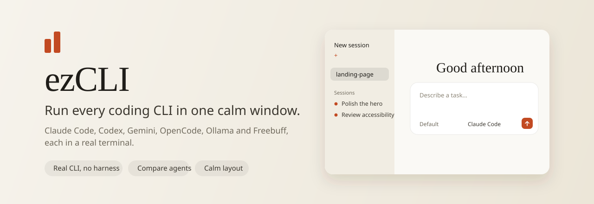
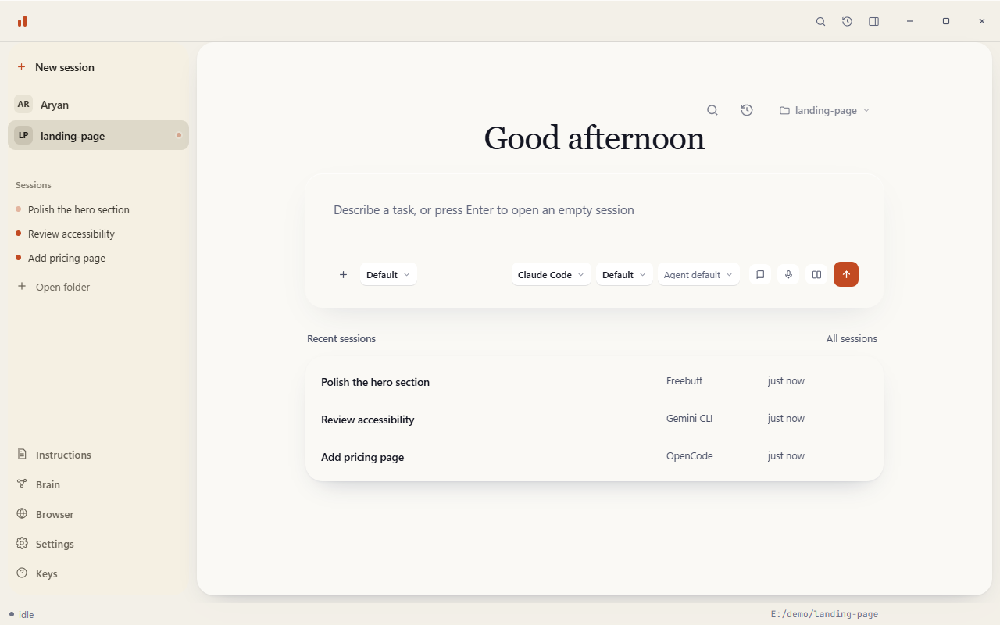
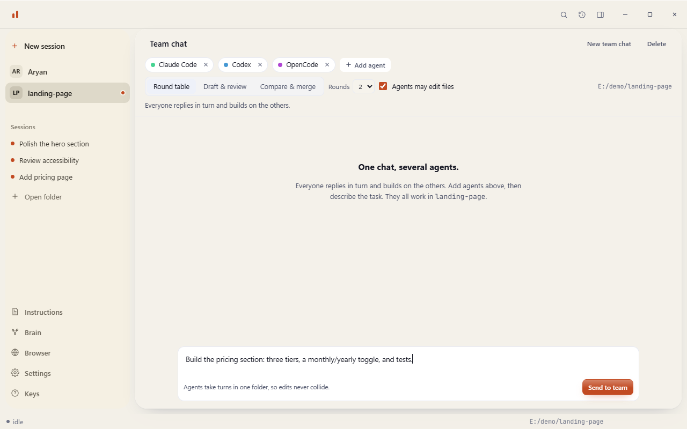
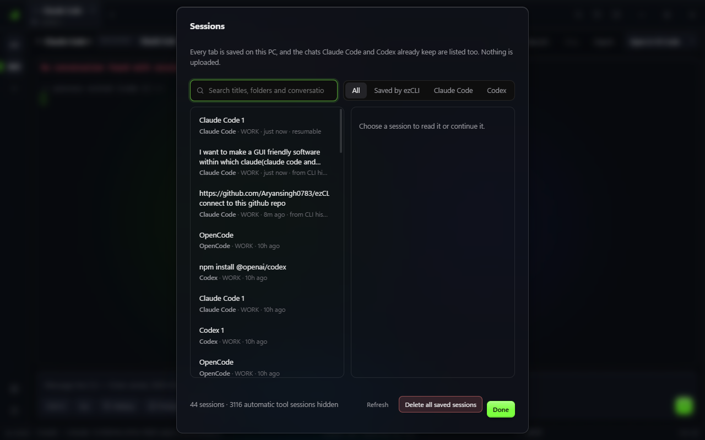
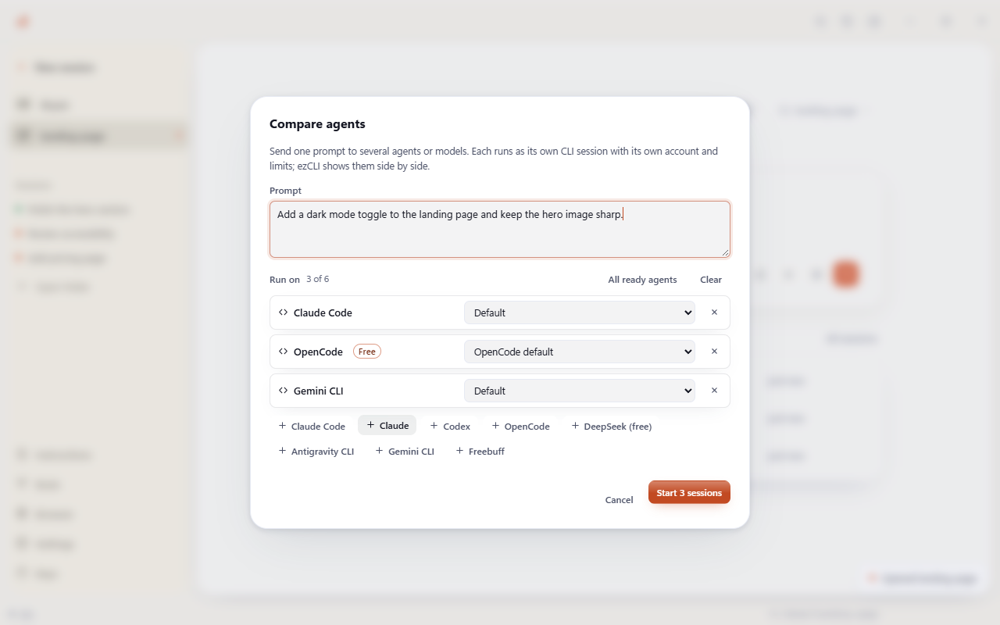
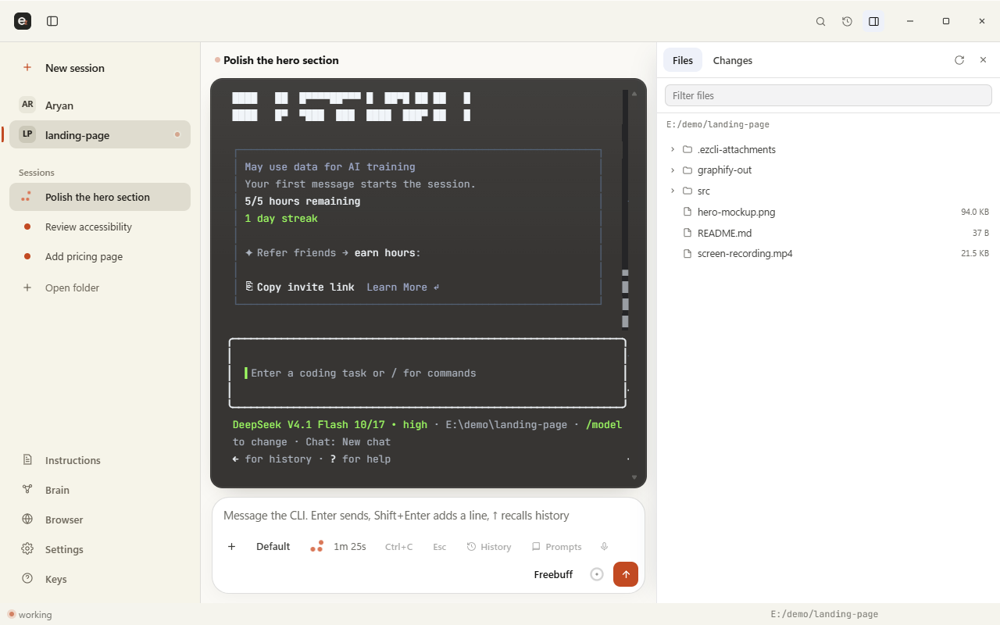

<p align="center">
  
</p>

<p align="center">
  A liquid-glass desktop window for Claude Code, Codex, OpenCode, Antigravity, Gemini CLI, Ollama and Freebuff.
</p>

---

ezCLI is not a harness. Each session spawns the real CLI in a real pseudo-terminal, so
the agent's own text UI renders unchanged. Nothing is proxied, re-prompted, or rewritten.
The window adds the parts a bare terminal lacks: tabs, an agent switcher, a file and diff
browser with git actions, model, effort and mode flags you pick before launch, images and
videos in the chat, and a compare mode that runs one prompt on several agents at once.











## Install

Download from the [Releases page](https://github.com/Aryansingh0783/ezCLI/releases/latest):

| Platform | File |
| --- | --- |
| Windows | `ezCLI_x.y.z_x64_en-US.msi` |
| macOS (Apple silicon) | `ezCLI_x.y.z_aarch64.dmg` |
| Linux | `ezCLI_x.y.z_amd64.deb` or `ezCLI_x.y.z_amd64.AppImage` |
| VS Code | `ezcli-x.y.z.vsix`, then Extensions › … › Install from VSIX |

The app writes its editable config to `~/.ezcli/agents.json` on first run. After that,
ezCLI checks for new releases at startup and installs them with one click; an update is
installed only when its download matches the SHA-256 published with the release.

The macOS and Linux builds are new and less tested than Windows. PC control and voice
typing are Windows-only for now.

## Free users and backend support

ezCLI launches local CLIs; it does not include, proxy, or bill for model
access. During onboarding it checks which CLI commands are installed and whether
a local sign-in or API-key configuration is present. It does not inspect your
subscription, balance, or provider account.

If no ready Claude Code or Codex backend is found, ezCLI recommends the first
installed free agent instead of sending you to a known paid-plan gate. A
**Free** badge means that the CLI has a route that does not require a paid
plan—it does not mean that every model supplied by an optional connected
provider is free.

| Backend | Free route | PC control | Install / setup |
| --- | --- | --- | --- |
| OpenCode | Yes. It includes key-free models and can also use connected providers or local Ollama. Its Model menu is refreshed from `opencode models`. | Yes | `npm install -g opencode-ai` |
| Antigravity CLI | Yes, with a personal Google-account sign-in. It is the supported personal-Google route. The Antigravity desktop app does not include this CLI. | No | `irm https://antigravity.google/cli/install.ps1 \| iex` |
| Gemini CLI | Not through personal Google login. Use a Gemini API key, Vertex AI, or an enterprise configuration. | No | `npm install -g @google/gemini-cli` |
| Ollama Local | Yes, after you choose a model that is already downloaded locally. The app detects coarse PC capacity to explain this route, but never pulls a model itself. | No | `irm https://ollama.com/install.ps1 \| iex` |
| Ollama Cloud | Your signed-in Ollama account and its usage/plan limits apply. The Model pill reads Ollama's live public cloud catalog; it launches the matching Cloud CLI alias without a model download. | No | Install Ollama, then run `ollama signin` yourself |
| Freebuff | Yes, ad-supported. It chooses models server-side and completes its own setup on first use. | No | `npm install -g freebuff` |
| Claude Code | No Claude Free-plan route. Use a paid Claude plan or API access. | Yes | `npm install -g @anthropic-ai/claude-code` |
| Codex | Account/API access dependent. Some ChatGPT Free accounts may have limited access, but ezCLI does not assume it as its fallback. | Yes | `npm install -g @openai/codex` |
| Claude | No separate free route; this is the `claude` CLI configuration. | No | Installed with Claude Code |
| ChatGPT | No bundled free route; enabled only when a compatible `chatgpt` executable is already on `PATH`. | No | Provide that executable on `PATH` |

PC control gives the agent a screenshot tool plus real mouse and keyboard
control (move, click, scroll, type, key combos) and an agent-driven in-app
browser, all through a local tool server. It is attached at launch — switching
it on or off restarts the session — and works with **Claude Code**, **Codex**
and the free **OpenCode**/**DeepSeek** backends. It is off until you turn it on
per session, and the grant ends when that session exits.

### Ollama: local capacity versus cloud capacity

ezCLI reads only coarse local facts—logical CPU cores, total RAM, and the
largest dedicated GPU VRAM—to explain whether a downloaded local model is
likely to be practical. Those facts **never** filter or cap the Cloud model
menu: cloud inference runs remotely. Entries with a published nonzero size
appear before entries that do not report a comparable size; this is only a
browsing hint, not a claimed quality or coding ranking. Account access,
quotas, and model availability are ultimately enforced by Ollama when the CLI
starts.

ezCLI does not install Ollama, run `ollama signin`, download a model, or handle
an Ollama API key. It uses the signed-in local CLI only after you choose a live
catalog entry.

## Current features

### New in 2.1

- **Team chat.** `Ctrl+Alt+G`. Pick two to five agents (for example Claude Code, Codex
  and OpenCode) and they work in **one** conversation: each reads what the others
  said, builds on it and corrects it. Three ways to work together: Round table,
  Draft and review, or Compare and merge. Agents may edit files, one at a time. If a
  model is overloaded or rate limited, ezCLI switches to a comparable one and says so.
- **Sessions that survive.** Every tab is saved on this PC. Close the app, reopen it,
  and the tab is back with its text; Resume continues the same Claude Code or Codex
  conversation by id. `Ctrl+Alt+H` lists everything, including the chats those CLIs
  already keep, and the home screen offers one-click Continue cards.
- **Free models only.** Ollama Cloud, OpenCode and DeepSeek list only models that cost
  nothing, and every PC shows the same list.
- **Safer sending.** One Enter in the composer submits one message. ezCLI never types
  into a CLI's update, trust or sign-in question.

### New in 2.1.2

- **Install an agent without leaving ezCLI.** The Health check panel and
  onboarding's "What ezCLI found" box now have an **Install** button next to
  each missing free agent's command, not just Copy. It shows the exact
  command first, runs it only after you confirm, and streams the real
  output live — the same thing you'd see running it yourself in a terminal.

### New in 2.1.1

- **Real PC control, for free models too.** PC control is no longer screenshot-only:
  an agent you grant it to can move the mouse, click, scroll and type, and it now works
  with the free **OpenCode** and **DeepSeek** backends as well as Claude Code and Codex.
- **An agent-driven in-app browser.** The agent can open a separate ezCLI browser window
  and navigate, read (by screenshot), click and type in it — a contained browser it
  controls, not your whole desktop. The page it loads cannot reach back into ezCLI.
- **Fixes.** The `Ctrl+Alt+G` team-chat shortcut now works, and scroll direction is
  consistent (down is positive).
- **Optional Strata support.** Paste your own [Strata](https://klavis.ai) MCP server
  URL in Settings and a per-session chip offers it to agents, off by default. ezCLI
  never creates an account or connects anything on its own — see
  [PC control and its permission model](#pc-control-and-its-permission-model).

### Guide: what each feature does

| Feature | What it does | How to use it |
| --- | --- | --- |
| Agent, Model, Effort, Mode pills | Choose which CLI starts and how | Click a pill on the home screen before sending |
| Team chat | Several agents in one conversation | `Ctrl+Alt+G`, add agents, pick a mode, describe the task |
| Compare | The same prompt in separate sessions side by side | `Ctrl+Alt+M` |
| Sessions | Everything saved on this PC, plus Claude Code and Codex history | `Ctrl+Alt+H`, then Resume or Continue |
| Attach | Images and videos in the chat | Attach button, paste with `Ctrl+V`, or drop files |
| Changes pane | Review, stage, commit or discard what the agent changed | `Ctrl+Alt+B`, then Changes |
| PC control | Let an agent see and operate your screen, or drive the in-app browser | PC control chip in the session header |
| Strata (optional) | Offer a third-party MCP tool server you set up yourself | Settings → Strata, then the Strata chip in the session header |
| Command palette | Search every action | `Ctrl+Alt+P` |
| Prompt library | Saved prompts with fill-in `{{variables}}` | `Ctrl+Alt+L` |
| Search and export | Find text in past sessions, save one as Markdown or HTML | `Ctrl+Alt+F`, `Ctrl+Alt+E` |
| Health check | Which CLIs are installed and signed in, with install commands | Settings, Health check |
| Updates | Install new releases from inside the app | The Update badge in the title bar, or Settings |
| Remote view | Watch sessions from a phone on your Wi-Fi | Settings, Remote view |
| Web chat | Provider websites in their own window (experimental) | Home screen, Web chat |
| Voice typing | Dictate into the message box (Windows) | `Ctrl+Alt+D` |

More detail for each is in [GUIDE.md](GUIDE.md).

### New in 2.0

- **Compare agents.** Press `Ctrl+Alt+M`, pick up to six agents or models (or "All
  ready agents"), and give one prompt. Each runs as its own CLI session, and the
  window shows them side by side. "Send to all" sends every follow-up to the whole
  group. Each session uses its own account and limits.
- **Liquid glass.** Frosted panels over a slow aurora in your accent colour, with
  small controls that refract what is behind them. Settings › Appearance switches
  to Solid. Six accent colours.
- **Command palette.** `Ctrl+Alt+P` searches every action, tab, folder and agent.
- **Health check.** One screen with every CLI's version, path and sign-in state, and
  the exact install command for anything missing. A provider's desktop app is not
  its CLI; this screen says so.
- **Updates.** ezCLI checks GitHub at startup and installs a new release with one
  click after verifying its SHA-256.
- **Prompt library.** Saved prompts with `{{variables}}` that are filled in before
  insertion. `Ctrl+Alt+L`.
- **Search past sessions.** Tab text is saved on this PC when a session ends, kept
  for 30 days, and searchable with `Ctrl+Alt+F`. Turn it off in Settings.
- **Export.** Save a session as Markdown or an HTML page (`Ctrl+Alt+E`).
- **Git actions.** Stage, unstage, discard and commit from the Changes pane.
  Discarding asks first.
- **Usage-limit router.** When an agent says it is out of usage, a banner offers to
  continue in another installed agent, free ones first, with a summary of your
  recent requests.
- **Notifications and tray.** A notification when a long task finishes in a tab you
  are not looking at. Optionally keep running in the tray when the window closes.
- **Per-folder defaults.** Each folder remembers the agent, model and mode it last
  launched with.
- **More windows.** Open a new window, or right-click a tab and move it, still
  running, into its own window.
- **Remote view.** Watch your sessions from a phone on the same Wi-Fi through a
  private link and QR code. Typing from the phone is a separate switch.
- **Voice typing.** `Ctrl+Alt+D` opens Windows voice typing in the message box.
- **Web chat (experimental).** For plans with no CLI access, such as Claude Free,
  open the provider's own site in a separate window with no ezCLI permissions.
- **VS Code extension.** Start agents from your ezCLI setup in VS Code terminals,
  compare them side by side, or open a folder in the app.

### Earlier

- **Sessions survive restarts.** Every open tab comes back as a "parked" tab on next
  launch, with a Resume button that relaunches the same agent, model, mode and folder.
- **Promoted launch controls.** Labeled Agent, Model, Effort and Mode pills on
  the launcher make the configuration explicit before a CLI starts. Claude and
  Codex expose their supported effort levels; agents that do not expose one
  retain their own default. The live session head gets its own Model chip too.
- **Images and videos in chat.** Click **Attach**, paste a screenshot
  (`Win+Shift+S`, then `Ctrl+V` in the composer), or drop files on the window.
  Each CLI gets the file the way it actually reads pictures: Claude Code and
  Codex attach the image in their own composer (`[Image #1]`), OpenCode and
  Gemini get an `@path` mention, Ollama gets the path in the prompt
  (multimodal models only). Gemini reads video directly; for the other agents
  ezCLI samples six still frames with your own `ffmpeg`. Nothing is uploaded
  by ezCLI; the files stay on your PC and the CLI reads them locally.
- **Free and Paid labels.** The Model menu marks Ollama Local and Freebuff models
  **Free**, and marks each Ollama Cloud model **Free** (starter credits on a free
  Ollama account) or **Paid**. Ollama does not publish its free list, so the
  labels come from `modelPricing` in `agents.json`; edit that list if Ollama
  changes it. Ollama always makes the final check when a model starts.
- **Usage view.** Honest local counters, plus one-click shortcuts to the Anthropic Console
  and OpenAI Dashboard where the real billing lives.
- **Local chat import.** A read-only picker for recognized Claude Code transcripts. It never
  uploads a chat or silently turns one into prompt context.
- **Home opens in your home folder** instead of `C:\Program Files\ezCLI` when you launch
  from the Start Menu.
- Polish: tab enter animation, status-bar glow when a session is working, primary-button
  depth, brand mark shimmer on hover.

## Build from source

ezCLI is a Rust desktop app built with Tauri 2 and a vanilla HTML/CSS/JS frontend.

Prerequisites:

- Rust (stable, 2021 edition). On Windows the GNU toolchain works without MSVC Build Tools:
  `rustup toolchain install stable-gnu && rustup default stable-gnu`.
- The Tauri CLI: `cargo install tauri-cli --version "^2.0"`, or download the prebuilt
  binary from the [Tauri releases](https://github.com/tauri-apps/tauri/releases).
- WebView2 Runtime (shipped with Windows 11; Windows 10 users get the Evergreen bootstrapper).
- `git` on PATH, if you want the Changes pane.

Then:

```bash
git clone https://github.com/Aryansingh0783/ezCLI.git
cd ezCLI
cargo tauri dev        # live window, Rust hot-reload on save
cargo tauri build      # produces src-tauri/target/release/bundle/msi/ezCLI_<version>_x64_en-US.msi
```

## What it does

| Area | Behaviour |
| --- | --- |
| Session tabs | One pseudo-terminal per tab. A colored dot shows running, exited, or failed. |
| Agent switcher | Claude Code, Claude, Codex, ChatGPT, OpenCode, Antigravity CLI, Gemini CLI, Ollama Local, Ollama Cloud and Freebuff. A CLI that is not on PATH shows as disabled instead of failing on launch. |
| Model, effort and mode chips | Map to real CLI flags from `agents.json`. You set them before launch; a running session locks them until you restart. |
| Terminal | xterm.js with the Freebuff dark palette and JetBrains Mono. Full color, cursor, and live resize. |
| Files pane | Browse the session folder and preview any text file, up to 256 KB. |
| Changes pane | Branch, working-tree status, and a colored diff for each changed file, straight from `git`. |
| Composer | A text box that writes to the process, with `Ctrl+C` and `Esc` buttons for the agent's own prompts, and an **Attach** button for images and videos. Paste screenshots with `Ctrl+V` or drop files on the window. |
| Status bar | State, the resolved command line, the working directory, and the terminal size. |
| Local chats | Read-only import picker for recognized Claude Code JSONL conversations. Unsupported stores stay unavailable rather than being guessed. |

Full operating instructions are in [GUIDE.md](GUIDE.md).

## Keyboard

The window claims only `Ctrl+Alt` combinations, so the agent's own terminal shortcuts
(`Ctrl+C`, `Ctrl+W`, `Ctrl+R`, and the rest) always reach the CLI.

| Keys | Action |
| --- | --- |
| `Ctrl+Alt+N` | New session |
| `Ctrl+Alt+W` | Close session |
| `Ctrl+Alt+B` | Show or hide the sidebar |
| `Ctrl+Alt+K` | Clear the terminal |
| `Ctrl+Alt+1` … `9` | Jump to a session |
| `Enter` | Send the composer |
| `Shift+Enter` | New line in the composer |
| `Ctrl+V` (in the composer) | Attach a copied image or screenshot |
| `Ctrl+Alt+P` | Command palette |
| `Ctrl+Alt+M` | Compare agents |
| `Ctrl+Alt+L` | Prompt library |
| `Ctrl+Alt+F` | Search past sessions |
| `Ctrl+Alt+E` | Export the session as Markdown |
| `Ctrl+Alt+D` | Voice typing (Windows) |

## Configuring agents

`agents.json` lists every launchable CLI. Each entry gives a `command` resolved on PATH,
plus `modes`, `models` and optional `efforts` whose `args` are appended to the launch line. Edit the file,
then click **Reload agents** in Settings. No restart needed.

```json
{
  "id": "claude-code",
  "label": "Claude Code",
  "command": "claude",
  "modes": [
    { "id": "plan", "label": "Plan", "args": ["--permission-mode", "plan"] }
  ],
  "models": [
    { "id": "opus", "label": "Opus", "args": ["--model", "opus"] }
  ],
  "efforts": [
    { "id": "high", "label": "High", "args": ["--effort", "high"] }
  ]
}
```

Detected on a typical setup:

- Claude Code, from `claude`
- Claude, from `claude`
- Codex, from `codex --no-daemon` (live model list via `codex debug models`)
- ChatGPT, disabled until a `chatgpt` binary is on PATH
- OpenCode, from `opencode` (live model list via `opencode models`)
- Antigravity CLI, from `agy` (personal Google route)
- Gemini CLI, from `gemini` (API-key, Vertex AI or enterprise route)
- Ollama Local / Cloud, from `ollama` (Cloud catalog is read from Ollama's public endpoint; `ollama signin` remains user-controlled)
- Freebuff, from `freebuff`

### Why Codex passes `--no-daemon`

Codex normally detaches a background server. When ezCLI runs inside a Windows job object
that forbids breakaway, that detach fails and Codex exits at once. The flag keeps Codex in
the foreground. Remove it from `agents.json` if your setup does not need it.

## Local chat import

Open **Settings → Import local chats** to scan supported transcript stores. The
current importer supports only Claude Code, and only recognizes explicit `user`
and `assistant` text records. Malformed JSONL, tool payloads, oversized files,
and unverified sources are ignored. The app keeps an opened transcript in memory
for a read-only preview; it does not upload it, modify it, or attach it to a
new CLI session as hidden context.

Claude Code's supported local locations are:

| Platform | Location |
| --- | --- |
| Windows | `%USERPROFILE%\.claude\projects\**\*.jsonl` |
| macOS / Linux | `~/.claude/projects/**/*.jsonl` |

Claude Desktop, ChatGPT desktop, and Codex import are intentionally listed as
unavailable for now. Their local store formats have not been verified in this
project, so ezCLI does not probe guessed paths or claim compatibility.

## PC control and its permission model

PC control lets an agent see and operate your computer through tools that ezCLI
provides. It is off for every session until you turn it on, and it costs no
tokens while off.

**What the agent can do when it is on:**

- `screenshot` — your primary display as a PNG, at most 1280 px wide.
- `move_mouse`, `click`, `scroll` — move and click the mouse at screen pixels.
- `type_text`, `press_key` — type text and press keys/combos (e.g. `ctrl+c`).
- An in-app browser it drives on its own: `browser_navigate` opens a separate
  ezCLI browser window (not your desktop), and `browser_screenshot` /
  `browser_click` / `browser_type` / `browser_key` / `browser_scroll` /
  `browser_nav` read and operate just that window. The page it loads has no
  access back into ezCLI.

It still cannot run shell commands through ezCLI — only the tools above.

**How you turn it on:** use the **PC control** chip in the session header. The
agent only learns about tools when it starts, so turning PC control on restarts
that session with ezCLI's tool server attached. A confirmation tells you the
current conversation in that tab ends. Turning it off restarts it without the
tool server.

**How the permission is enforced:**

- The tool server listens only on `127.0.0.1` and rejects requests whose Host
  header is not loopback.
- Each granted session gets its own random 128-bit address. One session cannot
  reach another session's tools.
- Every tool call re-checks two things in the Rust backend: that you granted
  this session, and that its process is still running. The backend enforces
  this itself, so a revoke holds even if the window reloads.
- Permission covers one process. It ends when the process exits, when you close
  the tab, when you press Restart, or when you turn it off. Relaunching asks
  again.
- Nothing an agent prints can grant permission. Only the chip can.

**Supported agents:** Claude Code (attached with `--mcp-config`), Codex
(attached with `-c mcp_servers.ezcli.url=…`), and the free **OpenCode** and
**DeepSeek** backends (attached via `OPENCODE_CONFIG_CONTENT`). Other built-in
agents, including the Claude chat preset, keep the chip disabled.

**Verified so far:** screen capture on Windows (1920x1080 to 1280x720 in about
0.2 s); real input injection (`move_mouse`, `click`, `scroll`, `type_text`,
`press_key`); the in-app browser's `browser_navigate`/`screenshot`/`click`/
`scroll`/`nav` chain, including its own `PrintWindow`-based capture; the tool
server's protocol, grant, and revoke behaviour over real loopback HTTP in unit
tests; and end-to-end runs where a live Claude Code session drove every tool
above directly through the server. The tests count real tool invocations, so
a model claiming an action cannot pass it. Codex and OpenCode/DeepSeek attach
the same way but have not been run end to end yet.

### Strata (optional, third-party)

Settings → **Strata** lets you paste the URL of a [Strata](https://klavis.ai)
MCP server — a separate product from Klavis AI, not part of ezCLI — and offer
it to a session the same way PC control works: a chip in the header, off by
default, one process at a time. **ezCLI never creates a Klavis account, calls
Klavis's API, or installs anything on your behalf** — you set up Strata
entirely yourself (their hosted dashboard, or the open-source `strata-mcp` CLI
run locally) and hand ezCLI only the resulting URL. Leave the field blank and
Strata is completely inert: no chip appears, nothing is attached, nothing is
sent anywhere. The URL is only ever passed to the CLI you're already running,
the same loopback-only trust boundary as ezCLI's own MCP server; it is never
uploaded anywhere by ezCLI itself.
Screen capture is Windows-only for now.

## How it works

```
src-tauri/
  Cargo.toml            manifest, release profile, dependencies (tauri, portable-pty, …)
  tauri.conf.json       window geometry, bundle targets, icons
  capabilities/         Tauri 2 permission ACL
  src/
    main.rs             tiny entry point
    lib.rs              Tauri command handlers wiring the modules below
    agents.rs           agents.json parsing, PATH + PATHEXT resolution
    import.rs           read-only local transcript discovery and normalization
    pty_mgr.rs          portable-pty session store, reader + wait threads, resize + kill
    files_api.rs        directory listing, 256KB text preview, binary heuristic
    git_api.rs          git status / diff via std::process
    media.rs            pasted images, workspace staging, ffmpeg video frames
    features.rs         commands for the v2 features below
    health.rs           CLI and tool versions, sign-in presence
    transcripts.rs      saved session text and search
    updater.rs          GitHub release check, SHA-256 verified install
    remote.rs           token-gated remote view server (+ remote_page.html)
    tray.rs             system tray icon
    backends.rs         installed-CLI and sign-in detection for onboarding
    capture.rs          primary-screen capture for PC control
    mcp_server.rs       loopback MCP tool server for PC control
  icons/                generated from docs/icon.png

public/                 the frontend, served from inside the Tauri window
  index.html            window markup
  styles.css            Freebuff design tokens and components
  app.js                calls backend via window.__TAURI__.core.invoke
                        + window.__TAURI__.event.listen
  features/             one script per v2 feature, plugged into app.js hooks;
                        glass.css / glass.js hold the liquid glass style
  vendor/               xterm.js + addons, vendored (no bundler)

vscode-ezcli/           the VS Code extension (plain JavaScript, no build step)
agents.json             shipped default; copied to ~/.ezcli/agents.json on first run
```

When you start a session, the Rust side spawns the CLI with `portable-pty`, keeps the
PTY master, and runs two threads: one pumps every byte the child writes to the frontend
as a `pty-data:<id>` event, one waits for the child and emits a single `pty-exit:<id>`.
Launch arguments only ever come from `agents.json`, never from JavaScript.

ezCLI makes zero model calls of its own. The agent CLIs do all the talking to their
providers, exactly as they would in your shell, so running the window costs nothing
beyond what the CLIs already use. The Tauri frontend talks to the Rust core over IPC;
there is no Node server or WebSocket relay.

## Requirements

- `git` on PATH, for the Changes pane
- At least one of the agent CLIs installed
- `ffmpeg` on PATH, only to send videos to agents other than Gemini (`winget install Gyan.FFmpeg`)

## Design source

The base tokens (radii, type scale, spacing, the lime accent) come from the Freebuff
dark shell and sit at the top of `public/styles.css`. The liquid glass style in
`public/features/glass.css` layers translucent surfaces, a backdrop blur, and an SVG
displacement filter over those tokens, so every accent colour and both themes apply to
it. The spotlight cards and the glowing border on the home box are vanilla
re-implementations of ideas from React Bits and 21st.dev; no React or bundler is added.
The frontend passes the Impeccable design detector with no findings.

## License

MIT. See [LICENSE](LICENSE).
