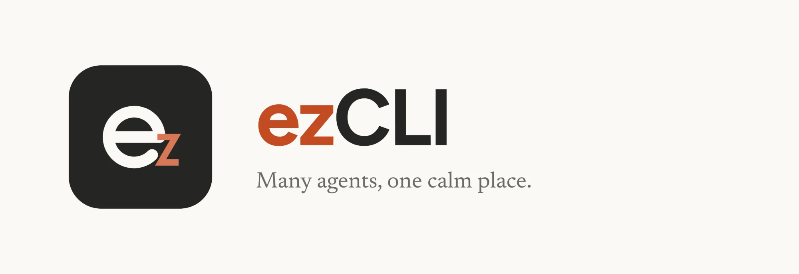
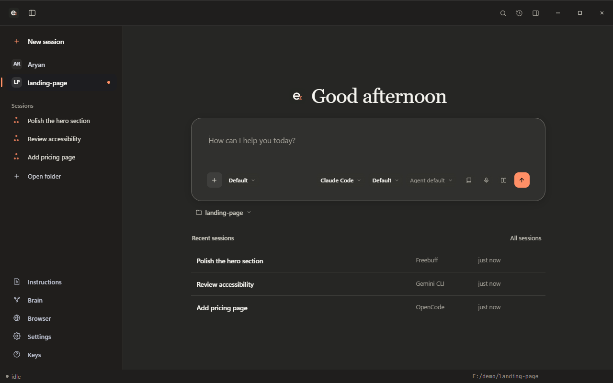
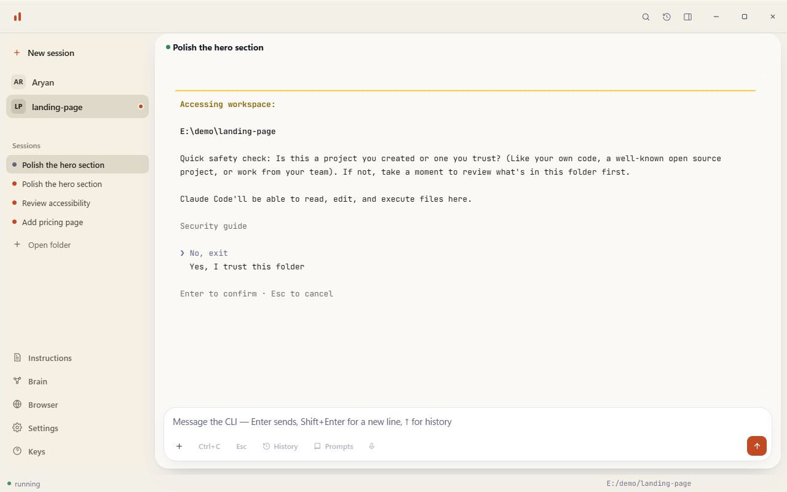
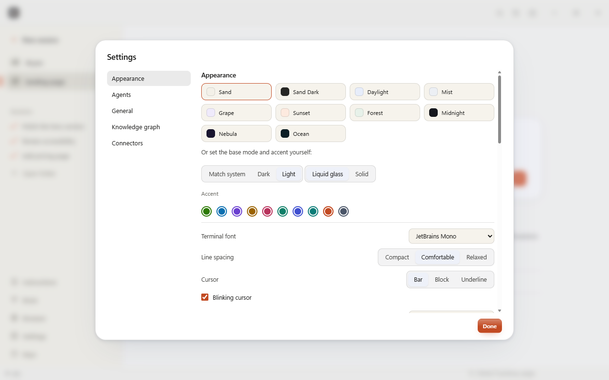

<p align="center">
  
</p>

<p align="center">
  A calm desktop window for Claude Code, Codex, OpenCode, Antigravity, Gemini CLI, Ollama and Freebuff.
</p>

---

ezCLI is not a harness. Each session spawns the real CLI in a real pseudo-terminal, so
the agent's own text UI renders unchanged. Nothing is proxied, re-prompted, or rewritten.
The window adds the parts a bare terminal lacks: a sidebar of your projects and sessions, an
agent switcher, a file and diff browser with git actions, model, effort and mode you pick
before launch, images and videos in the chat, usage meters, and a compare mode that runs one
prompt on several agents at once.









## Highlights

**A window that feels like a desktop chat app**

- **Sand and Sand Dark.** A flat, warm window modelled on the Claude desktop app: a tinted
  sidebar, one continuous content area, a serif greeting with the ezCLI mark, and a white
  message box. Seven other themes are one click away in Settings.
- **A sidebar that does the switching.** New session, your projects, the open project's
  sessions (with a status dot, or three moving dots while an agent works), earlier saved
  sessions with stars, then Instructions, Brain, Browser, Settings and Keys. Hide it with
  Ctrl+Alt+S, double-click a session to rename it, hover for a preview of its latest output,
  and move through it with the arrow keys.
- **The same message box for every agent.** The mode on the left; the model and effort on the
  right, then the usage ring and send. Click the mode or the model to change it.
- **Usage meters.** The ring shows how full the context window is. Click it for the context
  window and **Plan usage limits** as thin bars with reset times, read from each CLI's own
  files with no network request. CLIs that report nothing show a marked estimate.
- **A transparent terminal.** The terminal sits directly on the window, in dark ink on a
  light theme and light ink on a dark one. Dark glass and Solid are in Settings, with the
  JetBrains Mono font, line spacing and cursor shape.
- **Settings with a section list**, an editor for the project's `CLAUDE.md`, `AGENTS.md` or
  `GEMINI.md`, and menus, dialogs and toasts in one consistent style.

**What is underneath**

- Claude Code, Codex, OpenCode, DeepSeek, Gemini CLI, Antigravity, Freebuff and Ollama, each
  as its own CLI in its own terminal, in any folder.
- Compare mode, team chat, a file and diff explorer, session search and resume, slash
  commands with suggestions, clickable file paths in the output, find in output, and a
  second-brain map of your projects that opens in Obsidian.
- Everything stays on your PC. ezCLI never handles an account or an API key.

Shortcuts are listed under [Keyboard](#keyboard).

## Install

**Windows, one line.** Paste this into PowerShell. It downloads the newest release, checks it
against the SHA-256 published with it, and runs the installer:

```powershell
irm https://raw.githubusercontent.com/Aryansingh0783/ezCLI/main/install.ps1 | iex
```

Then install agents from inside ezCLI; it sets up Node.js for them if your PC doesn't have it.

Or download from the [Releases page](https://github.com/Aryansingh0783/ezCLI/releases/latest):

| Platform | File |
| --- | --- |
| Windows | `ezCLI_x.y.z_x64_en-US.msi` |
| macOS (Apple silicon) | `ezCLI_x.y.z_aarch64.dmg` |
| Linux | `ezCLI_x.y.z_amd64.deb` or `ezCLI_x.y.z_amd64.AppImage` |
| Arch Linux / CachyOS | [`packaging/arch/PKGBUILD`](packaging/arch/PKGBUILD), see below |
| VS Code | `ezcli-x.y.z.vsix`, then Extensions › … › Install from VSIX |

The app writes its editable config to `~/.ezcli/agents.json` on first run. After that,
ezCLI checks for new releases at startup and installs them with one click; an update is
installed only when its download matches the SHA-256 published with the release.

The macOS and Linux builds are new and less tested than Windows. PC control and voice
typing are Windows-only for now.

### On a brand-new Windows PC

Most agents (Claude Code, Codex, OpenCode, DeepSeek, Gemini CLI, Freebuff) install through npm,
which comes with Node.js, and a fresh Windows has no Node.js. **You don't need to do anything
about it:** when you install one of these agents from ezCLI, it installs Node.js first. It uses
`winget` when that works, and otherwise downloads the official portable Node.js LTS from
nodejs.org, checks it against the SHA-256 nodejs.org publishes, and unpacks it to
`%LOCALAPPDATA%\Programs\nodejs` with no admin rights needed. Then the agent installs as usual.

If you'd rather set it up yourself, either of these works in PowerShell. Then restart ezCLI:

```powershell
winget install --id OpenJS.NodeJS.LTS -e
```

or download the LTS installer from [nodejs.org](https://nodejs.org) and run it. After that,
`npm install -g @anthropic-ai/claude-code` (or the agent's command shown in ezCLI) works.

### Arch Linux / CachyOS

There's no AUR package yet, but [`packaging/arch/PKGBUILD`](packaging/arch/PKGBUILD)
builds one locally: it downloads the official `.deb` from this repo's releases and
repackages it for pacman, so there's no Rust/Node toolchain to install:

```bash
git clone --depth 1 https://github.com/Aryansingh0783/ezCLI.git
cd ezCLI/packaging/arch
makepkg -si
```

Verified in a clean Arch Linux container: real `makepkg` build, real download and
checksum, install via `pacman -U`, and the installed binary actually starting GTK and
WebKit under a virtual display with no missing libraries. CachyOS uses the same
package format and official repos as Arch, so this works there unchanged. **On
SteamOS** (Steam Deck or another Steam Machine), use Distrobox instead of installing
directly: the root filesystem is read-only there, see [`AGENTS.md`](AGENTS.md) for
the exact steps. That file is also written so you can just point an AI coding agent at
this repo and ask it to install ezCLI for you on an Arch-based system. To use it on
a newer ezCLI release, bump `pkgver` in the `PKGBUILD` and replace the first
`sha256sums` entry with the value from that release's `ezCLI_<version>_amd64.deb.sha256`
asset, then run `makepkg -si` again.

## Free users and backend support

ezCLI launches local CLIs; it does not include, proxy, or bill for model
access. During onboarding it checks which CLI commands are installed and whether
a local sign-in or API-key configuration is present. It does not inspect your
subscription, balance, or provider account.

If no ready Claude Code or Codex backend is found, ezCLI recommends the first
installed free agent instead of sending you to a known paid-plan gate. A
**Free** badge means that the CLI has a route that does not require a paid
plan, it does not mean that every model supplied by an optional connected
provider is free.

| Backend | Free route | PC control | Install / setup |
| --- | --- | --- | --- |
| OpenCode | Yes. It includes key-free models and can also use connected providers or local Ollama. Its Model menu is refreshed from `opencode models`. | Yes | `npm install -g opencode-ai` |
| Antigravity CLI | Yes, with a personal Google-account sign-in. It is the supported personal-Google route. The Antigravity desktop app does not include this CLI. | No | `irm https://antigravity.google/cli/install.ps1 \| iex` |
| Gemini CLI | Paste a free Gemini API key in the session's setup field (ezCLI stores it in `~/.gemini/.env`). Personal Google login is not supported; use Antigravity CLI for that. | No | `npm install -g @google/gemini-cli` |
| Ollama Local | Yes, after you choose a model that is already downloaded locally. The app detects coarse PC capacity to explain this route, but never pulls a model itself. | No | `irm https://ollama.com/install.ps1 \| iex` |
| Ollama Cloud | Your signed-in Ollama account and its usage/plan limits apply. The Model pill reads Ollama's live public cloud catalog; it launches the matching Cloud CLI alias without a model download. | No | Install Ollama, then run `ollama signin` yourself |
| Freebuff | Yes, ad-supported. It chooses models server-side and completes its own setup on first use. | No | `npm install -g freebuff` |
| Claude Code | No Claude Free-plan route. Use a paid Claude plan or API access. | Yes | `npm install -g @anthropic-ai/claude-code` |
| Codex | Account/API access dependent. Some ChatGPT Free accounts may have limited access, but ezCLI does not assume it as its fallback. | Yes | `npm install -g @openai/codex` |
| Claude | No separate free route; this is the `claude` CLI configuration. | No | Installed with Claude Code |
| ChatGPT | No bundled free route; enabled only when a compatible `chatgpt` executable is already on `PATH`. | No | Provide that executable on `PATH` |

PC control gives the agent a screenshot tool plus real mouse and keyboard
control (move, click, scroll, type, key combos) and an agent-driven in-app
browser, all through a local tool server. It is attached at launch, switching
it on or off restarts the session, and works with **Claude Code**, **Codex**
and the free **OpenCode**/**DeepSeek** backends. It is off until you turn it on
per session, and the grant ends when that session exits.

### Ollama: local capacity versus cloud capacity

ezCLI reads only coarse local facts, logical CPU cores, total RAM, and the
largest dedicated GPU VRAM, to explain whether a downloaded local model is
likely to be practical. Those facts **never** filter or cap the Cloud model
menu: cloud inference runs remotely. Entries with a published nonzero size
appear before entries that do not report a comparable size; this is only a
browsing hint, not a claimed quality or coding ranking. Account access,
quotas, and model availability are ultimately enforced by Ollama when the CLI
starts.

ezCLI does not install Ollama, run `ollama signin`, download a model, or handle
an Ollama API key. It uses the signed-in local CLI only after you choose a live
catalog entry.

## Changelog

Every release, newest first.

### New in 2.1

- **Team chat.** `Ctrl+Alt+G`. Pick two to five agents (for example Claude Code, Codex
  and OpenCode) and they work in **one** conversation: each reads what the others
  said, builds on it and corrects it. Three ways to work together: Round table,
  Draft and review, or Compare and merge. Agents may edit files, one at a time. If a
  model is overloaded or rate limited, ezCLI switches to a comparable one and says so.
- **Sessions that survive.** Every tab is saved on this PC. Close the app, reopen it,
  and the tab is back with its text; Resume continues the same Claude Code or Codex
  conversation by id. `Ctrl+Alt+H` lists everything, including the chats those CLIs
  already keep, and the home screen offers one-click Continue cards.
- **Free models only.** Ollama Cloud, OpenCode and DeepSeek list only models that cost
  nothing, and every PC shows the same list.
- **Safer sending.** One Enter in the composer submits one message. ezCLI never types
  into a CLI's update, trust or sign-in question.

### New in 5.9.1

Fixes found by using the app the way you do, with real Claude Code sessions instead of sample data:

- **Your first message no longer shows twice.** Claude Code also logs a copy of each request, and
  the chat was reading it as a second message.
- **No more spinning dots on a finished reply.** Switching to a tab makes the CLI redraw, which
  counted as "working" and showed dots and a timer under an answer that was already done. The
  indicator now shows only while a reply is actually pending.
- **Tabs from last time open as a chat.** Reopening the app showed a parked tab as its old,
  garbled terminal screen. It now shows the conversation straight away, and typing a message
  resumes the session and sends it once the CLI is ready, instead of saying "not running".
- **Messages no longer get stuck in the CLI's input box.** A CLI that is still loading can drop
  the Enter, leaving your message typed but unsent. ezCLI now notices and presses Enter again (at
  most twice). It never acts on Claude Code's greyed-out prompt suggestion.

### New in 5.9.0

- **Long pastes fold.** A message with a long log or file folds to a short preview with "Show all
  N lines"; expanding it keeps your place. Copy and Edit still use the whole text.
- **A tidier first-run setup.** Your name and "Install all agents" now sit in one aligned block
  instead of crowding the top of the panel, and the install row only appears when something is
  missing. The install button is a normal button, so the panel's main action stays the clear one.

### New in 5.8.0

- **Install every agent in one click.** "Install all agents" (in first-run setup, Settings, Agents,
  and the command palette) lists every agent this PC is missing, shows the exact commands, and on
  one click installs them one after another in a single log, Node.js first if it's needed. One
  failing agent doesn't stop the rest; the summary says what was installed and what to retry.
  Each agent brings its own models; you sign in to each the first time you start it.
- **Agents that need their own setup step work with the newest npm.** npm 11.16 skips every
  package's install script by default, which can leave OpenCode without its program. ezCLI now
  allows the script of only the package being installed, never its dependencies.

### New in 5.7.2

- **Install ezCLI with one line** in PowerShell (see Install above): it finds the newest release,
  verifies the installer's SHA-256 and runs it. Works in Windows PowerShell 5.1 and PowerShell 7.
- **Safer releases.** A release now refuses to build if its tag doesn't match the version inside
  the app, so a tag on the wrong commit can no longer ship old code under a new number (which
  briefly happened with v5.7.0, since removed).
- The Node.js setup for agents now reads nodejs.org's checksum list the same robust way.

### New in 5.7.1

- **Agents install on a brand-new PC.** Most agents install through npm, which a fresh Windows
  doesn't have, so their install failed. Installing one from ezCLI now installs Node.js first if
  it's missing: through winget when that works, otherwise the official portable Node.js LTS from
  nodejs.org (checked against its published SHA-256, no admin rights needed). Every install also
  turns on TLS 1.2, which older Windows PowerShell leaves off, and Ollama falls back to winget if
  its download script fails. The README has the manual steps too.
- **Your name, not the PC's.** The home greeting no longer guesses a name from the Windows
  account folder. First-run setup asks what to call you, the home screen asks once if you skipped
  it, and Settings changes it any time. Until then it simply says "Good evening".

### New in 5.6.0

- **When a turn stops, the chat says so plainly.** A stop reason (for example "Free usage limit
  reached") is shown as a clear notice instead of ordinary text, with a button that puts your last
  message back in the box so you can retry after switching model or waiting.
- **See how long the agent has been working.** The working indicator now counts the time since
  you sent your message. The count updates in place, so text you have selected in the chat stays
  selected while the agent works.

### New in 5.5.1

- **OpenCode now shows as a chat.** OpenCode 2 no longer has the `export` command ezCLI relied
  on, so its sessions stayed in the terminal. ezCLI now reads the newest messages through
  OpenCode's own `api`, keeps them in a small cache, and shows your messages, its replies, tool
  calls with diffs, and why a turn stopped (for example "Free usage limit reached"). A long
  session no longer means downloading its whole history on every refresh.
- **OpenCode sessions resume properly.** Resuming an OpenCode tab used to say the conversation
  "was never stored" and start a new one, and a continued session was never matched to its tab.
  Both are fixed, and the session lookup now runs inside the project folder.

### New in 5.5.0

- **A living project graph.** With a project's graph turned on, ezCLI now keeps it up to date
  while agents work: a short while after each burst of work settles, it rebuilds the graph
  incrementally (local, no API key, nothing uploaded), folds the change into the second brain, and
  if the graph window is open it reloads in place so new files and connections appear on their own.
  Rebuilds are throttled per project and stay silent unless the graph is open.
- **Agents stay current.** Because the graph refreshes as work happens, an agent that queries it
  through the Graphify skill sees the project as it is now, not as it was at the start of the
  session. Set the skill up once from Settings, "Add Graphify to my agents".
- The Settings toggle now reads "Keep each project's graph up to date while agents work on it".

### New in 5.4.0

- **Connect Gemini CLI with an API key, from inside ezCLI.** Google dropped personal Google
  sign-in for Gemini CLI, so a Gemini session used to fail at its own sign-in. The Gemini notice
  now has a field: paste a free key from aistudio.google.com and ezCLI stores it where Gemini CLI
  reads it (`~/.gemini/.env`) and switches the CLI to API-key auth, then restarts the tab. The key
  stays on this PC; ezCLI never sends it anywhere and never shows it back. (Antigravity CLI is
  still the way to use a personal Google account.)

### New in 5.3.0

- **See what each edit changed.** When the agent edits a file, the folded tool line counts the
  lines it added and removed ("Edited 2 files +12 -3"), and opening it shows the change as a small
  coloured diff. This works for Claude Code, Codex (apply_patch), OpenCode and Freebuff.
- **File names are links.** A path in a reply (`src/app.js:42`) or in a tool line opens the file
  in the explorer. Ordinary code such as `console.log` stays plain.
- Fixed: a file path clicked in the terminal opened the explorer on the file list instead of
  the file.

### New in 5.2.0

- **Export is a clean conversation.** Export as Markdown or HTML now writes what you and the agent
  said, with tool calls listed under each answer, instead of a dump of the terminal screen.
- **Find works in the chat.** `Ctrl+Shift+F` highlights every match in the conversation, counts
  them, and `Enter` / `Shift+Enter` step through, opening folded tool calls when a match is inside one.
- **Faster long chats.** Finished messages are drawn once and reused, so a long conversation stays
  smooth while the agent is working.
- **Smaller touches.** Sending jumps to the bottom, a tool call that failed opens itself, and each
  message shows the time it was sent. Fixed: an open or closed tool group no longer carries over
  from one session to another.

### New in 5.1.0

- **The chat shows up sooner.** It takes over from the terminal as soon as the agent starts working
  on your message, not only after its first reply. If the agent is stuck on a question, the
  terminal stays up so you can answer it.
- **Message actions.** Hover a message for Copy, and Edit on your own, which puts it back in the
  message box. A "Latest" button appears when you scroll up, and typing anywhere in the chat goes
  to the message box.
- **Code blocks have colour** for comments, strings, numbers and keywords, and the message box
  says "Reply to <agent>" instead of "Message the CLI".

### New in 5.0.0

- **Sessions are a chat, not a terminal.** Your messages appear as bubbles, the agent's replies as
  formatted text (headings, lists, tables, code blocks with a Copy button, links), and its tool
  calls fold into one line you can open ("Ran 3 commands, Read 2 files"). The terminal window
  around it is gone. It keeps running underneath, and a **Chat | Terminal** switch in the header
  (`Ctrl+Alt+T`) shows it whenever you want, for sign-in screens, trust questions and anything a
  CLI asks that only the terminal can answer.
- **Exact for Claude Code, Codex, OpenCode and Freebuff.** ezCLI reads the conversation these
  CLIs already keep on this PC (Claude Code and Codex session files, `opencode export`, Freebuff's
  chat file), so tool calls and results are real, and the agent's private reasoning is left out.
  It only reads those files; nothing is written or sent.
- **Every other agent too.** Gemini CLI, Antigravity CLI, Ollama and the rest are shown from what
  you sent and what the agent printed, with borders, spinners and key hints removed. This is
  best effort: a full-screen app that draws its own screen stays in the terminal until it has a
  readable history, and a question the agent is waiting on is flagged with an "Open the terminal"
  button.
- Turn it off under Settings, General, "Show sessions as a chat".

### New in 4.10.0

- **Settings buttons look like buttons.** The action buttons in Settings (Sessions, Usage, Open
  second brain and the rest) have a visible outline again, and the connector name and URL fields
  share one height and corner radius.
- **Team chat starts from an example.** The empty team chat offers three example tasks for the
  mode you picked; click one to fill the message box. The view also sits on the same surface as
  the rest of the window instead of a cooler grey.

### New in 4.9.0

- **Starter ideas on the home screen.** Under the message box, a few one-click prompts fit the
  project you are in: "Review my 3 uncommitted changes" appears when git shows work in progress.
  A starter only fills the box, so you can edit it before sending, and it steps aside once you type.
- **The session title is a menu.** Click it for rename, duplicate, restart, copy folder path,
  move to a new window, export and close. `F2` renames the session right in the header.

### New in 4.8.0

- **See what the agent changed at a glance.** A pill in the session header shows the live count
  of changed files and lines ("3 files +42 -7") for the project's git repository. Click it for
  the list, and click a file to open its diff in the explorer. It refreshes while the agent works.
- **Search the sidebar.** The Search row under "New session" filters this project's open and
  saved sessions as you type. `Ctrl+Alt+O` opens it, Esc clears it.
- **Sessions that need you stand out.** A session with output you have not seen turns bold with
  an accent dot, stays visible even when the list is long, and `Ctrl+Alt+J` jumps to the next one.
- **Terminal frames and logos read on light themes.** Box lines and block art that a CLI draws in
  white or pale green (Gemini's welcome box and logo) are darkened until they are readable, and
  vertical frame lines are joined instead of dashed.
- **Esc closes the usage and changes panels** even while the terminal has focus, without sending
  the key to the CLI.

### New in 4.7.0

- **The usage ring sits under the model name.** In a session's message box the model and effort
  are on the right with the ring directly below, labelled with what it shows ("33% context", or
  "estimated" for a CLI that reports nothing). Click either to open the usage panel or switch
  model.
- **A calmer message box.** Ctrl+C, Esc, History, Prompts and dictation are folded into one
  "more" button beside the mode, so the footer is no longer a row of small chips. Everything is
  still one click away.
- **The sidebar list fades where it scrolls** instead of cutting a row in half.

### New in 4.6.0

- **A greeting that changes, like Claude's.** The home screen says something different for the
  time of day ("Good morning, Aryan", "Back at it, Aryan", "Still up, Aryan?") and sometimes a
  general line ("Welcome back", "What's on your mind?"). One line is chosen per launch and
  stays put while you work. The name comes from **Settings, General, Your name**, else your
  account's folder name; with neither, the line simply drops the name.
- The ezCLI mark that sat before the greeting is gone.

### New in 4.5.0

- **README refresh.** A Highlights section near the top describes the new look and features,
  with the new banner and logo and fresh screenshots of every main screen.
- **Fix: the explorer covered the message box in a narrower window.** The explorer now never
  takes more than the window can spare, so the session beside it keeps at least 320px.
- **Fix: the message box footer overflowed in a small window or with the explorer open.** It
  wraps onto a second line when the box is narrow.
- **Fix: the session header's buttons ran under the explorer.** The header now drops its chips,
  then Export and Open, as the session column narrows.

### New in 4.4.0

- **Our own mark in the greeting.** The spark that sat before the home greeting is replaced
  by the ezCLI logo.
- **The same footer for every agent and model.** In a session the message box now reads like
  the Claude desktop composer: the mode on the left, the model and effort on the right, then
  the usage ring and send. It works for every agent: a model left at its default shows the
  agent's name, and agents with no effort setting leave it out. Click the mode to restart in
  another mode, or the model to pick a different one.
- **Sidebar interactions.** Hide or show the sidebar with the button next to the logo or
  Ctrl+Alt+S. Double-click a session to rename it in place, hover one for a preview of its
  latest output, and move through the list with the arrow keys (Enter opens, F2 renames,
  Delete closes). Views fade in, rows glide in, and buttons answer a press.
- **No em dashes.** They are gone from the interface, the README and the guides, replaced by
  colons and commas, and a few messages were reworded for clarity.

### New in 4.3.0

- **The new ezCLI logo.** A rounded charcoal tile with a cream "e" and a terracotta "z",
  replacing the two bars. It is the app icon on Windows, macOS and Linux, the installer
  and tray icon, the mark in the title bar and the browser icon, and the README banner.

### New in 4.2.0

- **Usage meters, like the Claude desktop app.** A small ring in a session's message box
  shows how full the conversation's context window is. Click it for a panel with the context
  window and **Plan usage limits** as thin bars ("Current session, resets in 2 hr 4 min,
  29% used"), plus input, output, cached tokens, turns and cost. The numbers come from the
  CLI's own files and ezCLI makes no network request: context size for Claude Code, Codex
  and OpenCode, and Codex's real plan limits with reset times. A CLI that keeps nothing
  readable (Gemini, Ollama, Freebuff, Antigravity) shows a clearly marked estimate instead
  of an invented percentage. **All agents** opens a Usage view with one card per agent,
  remembering each agent's last reading. Claude Code does not record plan limits where
  ezCLI can read them, so it shows context and token numbers only.
- **Sidebar spacing.** One rhythm for every row: even insets so nothing touches the
  sidebar's rounded corners, a fixed leading slot so every label lines up, and clear gaps
  between groups.
- **Fix: Light / Dark with a palette of the other kind.** Picking Dark mode with a light
  palette (or the reverse) left light text on a white window in Settings and other dialogs.
  The matching palette is used instead, and your saved choice returns with its mode.
- **Fix:** links in dialogs use the accent colour instead of browser blue; a limit near its
  cap in the status bar is readable on light windows; project initials are readable in every
  theme and window style. Every theme, mode, accent and window style was scanned for contrast.

### New in 4.1.0

- **The working animation.** While an agent is working, three terracotta dots pass each
  other (two slide along while the third arcs over) with the elapsed time beside them,
  in the session's message box. A smaller copy replaces the status dot in the sidebar
  for any session that is working. Reduced-motion settings get still dots.

### New in 4.0.0

A big pass on the interface, modelled on the Claude desktop app.

- **Sand Dark.** A new theme built on Claude's dark colours, with the same flat window,
  sidebar and white-on-charcoal message box as Sand.
- **The model line in every session.** The message box in a session now shows the agent,
  model and effort on the right, like the model line in Claude's composer. Click it to
  switch models. "Default" values are left out so it only says what you chose.
- **Settings with a section list.** Appearance, Agents, General, Knowledge graph and
  Connectors are listed on the left; the current section is highlighted as you scroll.
- **Quieter home.** The floating search, history and folder buttons above the greeting
  are gone (the title bar already has search and history). The folder picker sits just
  under the message box. Recent sessions are a plain list with hairline dividers.
- **Menus, dialogs and toasts** follow the same style: rounded, hairline borders, soft
  shadows, plain hover washes, sentence-case headings.
- **Fix:** the Ctrl+C, Esc, History and Prompts buttons were drawn as dark tiles in some
  dark themes; they are flat now.

### New in 3.2.0

- **Closer to the Claude desktop app.** In the Sand theme the window is now flat, like
  Claude's: a tinted sidebar and title bar, one continuous light content area split by a
  hairline, no floating card. Claude's own light colours for text and borders, a white
  message box with a hairline border and soft lift, and a terracotta spark before a serif
  greeting. The message box asks "How can I help you today?".
- **Fix:** faint text on the tinted bars is darker so it stays readable.

### New in 3.1.2

- **Second brain: smaller, separated bubbles.** The bubbles in the second-brain map were
  so large they piled on top of each other and hid the lines between them. They are now
  about half the size, push each other apart, and stop growing past a sensible size on
  screen when you zoom in, so the connections and labels are readable.

### New in 3.1.1

- **Codex on Windows with a reasoning effort set.** Codex's npm launcher is a `.cmd`
  shim, and cmd.exe cannot carry a quoted setting like `model_reasoning_effort="high"`,
  so picking an effort could stop Codex from starting. ezCLI now runs Codex's own
  `codex.js` through Node directly, with each argument passed untouched. Only Codex's
  shim is treated this way, and only when Node and `codex.js` are found.
- **OpenCode Plan mode.** OpenCode 2 removed `--agent` from its main command, so Plan
  mode exited immediately. It now starts through `opencode mini --agent plan`, which
  still supports it. Edited mode arguments are left alone.

### New in 3.1.0

- **Transparent terminal.** The terminal pane now has no fill: it sits directly on the
  window. On a light window the text switches to dark ink; on a dark window it stays
  light. Pick **Transparent**, **Dark glass** or **Solid** under Settings, Terminal
  background. A few CLIs draw as if the screen were dark (a logo can look washed out on
  a light window); Dark glass fixes those. The graphics-card renderer always draws solid.
- **Fix:** the "Earlier" list in the sidebar disappeared when many sessions were open.
- **Fix:** the Instructions button is back in the compact sidebar.
- **Fix:** the composer pickers stay plain text with the Liquid glass style on.
- **Fix:** Open in Obsidian no longer says "Vault not found" (3.0.1).

### New in 3.0.3

- **Fix:** with the Liquid glass window style on (the default for existing installs), the
  composer pickers on the home screen got a pale wash and looked different from Solid.
  They are plain text in both now.

### New in 3.0.2

- **Fix:** the Instructions button was missing from the compact sidebar on narrow
  windows; it now shows there too.

### New in 3.0.1

- **Fix: "Vault not found" when opening the second brain in Obsidian.** Obsidian only
  opens folders it already lists as vaults. ezCLI now adds the second-brain vault to
  Obsidian's vault list (the same entry Obsidian writes for "Open folder as vault",
  leaving your other vaults untouched) and opens it by id. Obsidian reads that list
  only when it starts, so if it is already running ezCLI tells you to close it and try
  again instead of showing Obsidian's error.

### New in 3.0.0

The calm redesign, as a major release.

- **A new look, modelled on the Claude desktop app.** A warm Sand theme, a labelled
  sidebar with New session, your projects, the open project's sessions with
  stars, and Instructions, Brain, Browser, Settings. The tab strip steps aside on
  wide windows; the sidebar is the session switcher. A quiet home screen with one
  message box, and a composer footer with mode on the left and agent, model and
  effort on the right. Flat, borderless buttons. Turn it off under
  **Settings, Calm layout** for the old dashboard.
- **See-through terminal.** The terminal background is now transparent over a
  softly blurred pane, so the window colour shows faintly through it. Settings has
  a switch; it turns itself off while the experimental graphics-card renderer is on.
- **Project instructions** editor for `CLAUDE.md`, `AGENTS.md` and `GEMINI.md`.
- **Terminal:** bundled JetBrains Mono, slash-command suggestions, clickable file
  paths, Ctrl + wheel text size, copy terminal output, find in output.
- **Fixes from a full scan.** Every theme in both layouts was checked for duplicate
  ids, unnamed buttons and low-contrast text; the sidebar, active project name and
  Done button contrast were fixed. A lone tab no longer collapses, the session header
  no longer squeezes the title, and header buttons no longer wrap.

### New in 2.10.0

- **Composer footer like the Claude desktop app.** On the home screen the mode sits
  at the left and the agent, model and effort at the right as plain text with a
  caret, with a soft square send button.
- **Flat, borderless buttons** across the calm layout: a light wash on hover, 8px
  corners, one solid accent for the primary action.
- **Contrast fixes from a full scan.** Every theme, in both layouts, was checked for
  duplicate ids, unnamed buttons and text under 4.5:1. The sidebar labels on the
  light and dark themes, the active project name on light themes and the Done
  button on dark themes were below that and are fixed.

### New in 2.9.11

- **A quieter calm layout.** Less decoration: the filled "New session" button, the
  tiles behind project names and the dashed "Open folder" box are now plain rows
  that only gain a soft background on hover or when active. The home screen drops
  the quick-start chips and the date line, and the agent, model, effort and mode
  pickers fit on one row. Stars in the sidebar show on hover.

### New in 2.9.10

- **Sidebar colours follow every theme.** The new sidebar was only tuned for Sand;
  its text and highlights now adapt to the light and dark themes too, and project
  names stay readable on light themes.

### New in 2.9.9

- **Fix:** with the explorer open, the session header could squeeze the title
  down to nothing. The title now keeps a minimum width.

### New in 2.9.8

- **Earlier sessions and stars in the sidebar.** Under your open sessions the
  sidebar lists the project's saved sessions; click one to resume it. The star
  beside each pins it to the top, the same pin the home screen uses.

### New in 2.9.7

- **Project instructions.** A sidebar button (also in the command palette) opens
  an editor for the project's `CLAUDE.md`, `AGENTS.md` or `GEMINI.md`, picked by
  the agent, which the CLI reads at the start of every session. Saving creates
  the file if it does not exist.
- **Right-click a sidebar session** for the same menu the tabs had: rename,
  duplicate, restart, copy folder path, move to a new window.

### New in 2.9.6

- **New session row.** The calm sidebar starts with a "New session" button, like
  "New chat" in the Claude desktop app, and the duplicate + in the title bar is gone.
- **Warm terminal.** In the Sand theme the terminal pane is a warm charcoal that
  matches the rest of the window, instead of blue-black.

### New in 2.9.5

- **The sidebar is the session switcher.** In the calm layout on a wide window the
  tab strip steps aside: switch sessions from the sidebar list, and close one
  with the x that appears on hover. The + for a new session stays at the top.
  Narrow windows and the dashboard layout keep their tabs.

### New in 2.9.4

- **Sessions in the sidebar.** The calm sidebar lists the open project's sessions
  under its name, with a status dot; click one to switch to it. Like the recent
  chats list in the Claude desktop app.

### New in 2.9.3

- **Wide sidebar in the Sand theme.** Projects show their names beside their
  initials, with Open folder, Brain, Browser, Settings and Keys as labelled rows,
  like the Claude desktop app. Windows under 980px wide keep the compact icon rail.

### New in 2.9.2

- **Light sidebar in the Sand theme.** The project rail is now a soft, borderless
  column on the page colour, like the Claude desktop app, instead of a dark slab.

### New in 2.9.1

- **Fix:** the search box in Sessions no longer draws a double focus ring.
- The calm home lists your three most recent sessions.

### New in 2.9.0

- **Calm layout (new default).** A quieter, Claude-desktop-style look: a warm
  "Sand" theme with a terracotta accent, a serif greeting, one large message
  box with the agent, model and mode beside it, and quick starts as small
  chips. The stats tiles, agent grid and usage readouts are gone from view.
- **Controls appear when you reach for them.** In a session, Restart, Stop,
  Export and the header chips fade in on hover, and the Ctrl+C, Esc, History
  and Prompts buttons dim until you use the composer. The status bar no longer
  shows token counts or the raw command line.
- Turn it off under **Settings, Calm layout** to get the old dashboard back.
- **Fix:** the header chips no longer wrap onto two lines.

### New in 2.8.4

- **Fix: a lone tab was squashed.** With one session open, its tab shrank to a
  sliver and clipped the title. Tabs are full width again.

### New in 2.8.3

- **Clickable file paths in the terminal.** A path an agent prints, such as
  `src/app.js:42` or `C:\proj\main.rs`, opens in the explorer's file view
  when you click it. Version numbers and decimals are ignored.

### New in 2.8.2

- **Ctrl + mouse wheel** over the terminal changes the text size.
- **Copy terminal output.** A command-palette action copies the whole
  scrollback as plain text, with wrapped lines rejoined.

### New in 2.8.1

- **Slash-command suggestions.** Type `/` at the start of a message and the
  agent's own commands appear above the box. Up / Down to move, Tab or Enter
  to pick one, Esc to dismiss. Nothing is sent until you press Enter again.

### New in 2.8.0

- **A much better terminal.** Bundled JetBrains Mono (identical on every PC), a
  refined colour palette that follows the theme, comfortable line spacing, a bar
  cursor, correct widths for CJK and emoji, and a roomier inner margin.
- **Terminal settings.** Choose the font, line spacing and cursor shape, and
  turn the cursor blink or the experimental GPU renderer on or off.
- **Dim text stays readable.** Grey "dim" output is lifted to a legible contrast.
- **Fixes.** Session titles and tab labels no longer clip mid-word.

### New in 2.7.0

- **Find in terminal output.** Ctrl+Shift+F searches the whole scrollback as
  you type, with a match count, Enter / Shift+Enter to step through matches and
  Esc to close. Text the terminal wrapped across lines is found too.
- **Undo for closed tabs.** Closing a tab shows an Undo button.
- **Resume past sessions from the command palette.** Pinned sessions first.
- **Drag projects in the left rail to reorder them.**

### New in 2.6.0

- **Smoother, calmer motion.** Dialogs and menus ease in, switching between
  a session and the home screen fades, and changing theme cross-fades instead
  of snapping. All of it switches off when your system asks for reduced
  motion.
- **A greeting on the home screen** ("Good evening · Saturday, 24 October").

### New in 2.5.3

- **The home dashboard adapts to the space it really has.** With the file
  explorer docked beside it (or in a small window) the dashboard used to
  spill off the edge and scroll sideways. It now reflows column by column,
  hides the least important table column and stacks the composer. Checked at
  five window sizes with the explorer both open and closed.
- **Stats fixes.** A session with no agent name no longer shows "undefined"
  as your most-used agent, and a session dated in the future (a clock error)
  is no longer counted as today.

### New in 2.5.2

- **Fixed: terminal text was hard to read in the light themes.** Since the light default arrived the terminal pane has been dark, but its default text colour was still the dark-on-white set, so normal CLI output was dark on dark. The terminal now always uses its light-on-dark colours. Small labels (the Free tag, the changes count) are also darker on the light colour themes.

### New in 2.5.1

- **Readable secondary text.** An audit of every screen in a light and a dark theme found hint text, labels and chart letters well under the readable contrast level on the light themes; they are now darker (and slightly brighter on dark themes), and the lime accent is darker so white button text passes. All screens now pass.

### New in 2.5.0

A premium-feel pass:

- **ezCLI remembers its window.** Position, size, which monitor and
  maximized all come back on the next launch. If the saved spot is on a
  monitor that is no longer connected, it opens in the default place instead
  of off-screen.
- **Your week at a glance.** The home screen shows sessions this week with a
  seven-day chart, time spent with agents, and your most-used agent, all
  worked out locally from the sessions saved on this PC.
- **Pin sessions.** Hover a recent session and click the star to keep it at
  the top. Up/Down move between recent sessions and Enter opens one.
- **Your unsent first message is kept** if you close the app before sending.

### New in 2.4.2

Quality-of-life fixes:

- **Terminal copy and paste that works like a real terminal.** Ctrl+C copies
  when text is selected (and still interrupts the CLI when nothing is), Ctrl+C
  never gets in the way of stopping a run, and right-click copies a selection
  or pastes the clipboard.
- **Uninstalled agents are no longer dead cards.** Click one and ezCLI shows
  the exact install command and runs it only after you confirm.
- **Drop a folder on the home screen to open it as a project.**
- **Ctrl+Tab / Ctrl+Shift+Tab** switch between tabs.
- No more "Project graph updated" popup every time a session starts.

### New in 2.2.0

- **A second brain you can actually read.** ezCLI now draws its own map of
  your projects instead of using Graphify's viewer, which turned a large
  project (one Unity project alone was 97,000 symbols) into thousands of
  unnamed dots. Each circle is a named group of related code (for example
  `agents.rs: AgentDef, AgentOut`), with an index, search, a "where this code
  lives" file list, and the functions inside it. It works offline and stays
  smooth (about 240 fps here). Build time is a couple of seconds.
- **Builds skip junk.** Unity `Library`, `node_modules`, `target`, `dist`,
  `build`, virtualenvs and `vendor` folders are never indexed, so the graph
  shows your code, not your caches.
- **Obsidian notes** are exported per project on request (Settings →
  Knowledge graph → "Export notes for Obsidian").
- **Less clutter.** Settings went from nine sections to five: Usage, Sessions
  and the other launchers are now one row of buttons, Graphify and Second
  brain are one "Knowledge graph" section, and terminal text size lives under
  Appearance. The command palette no longer repeats Theme, Style and Accent
  (already in Settings) or "Import local chats" (same as Sessions).

### New in 2.1.12

- **A graph for every project, automatically.** When you start a session in a
  project folder, ezCLI builds (or refreshes) that project's
  [Graphify](https://github.com/safishamsi/graphify) knowledge graph in the
  background. It's on by default (Settings → Graphify), never installs
  anything by itself, skips your home folder and drive roots, and keeps
  `graphify-out/` out of your git status locally.
- **Second brain.** One graph merging every project's graph, plus an
  [Obsidian](https://obsidian.md) vault with a note per concept, all in
  `~/.ezcli/second-brain` on your PC. Open it from the new left-rail button,
  Settings → Second brain, or the command palette.
- The graph opens in its own ezCLI window instead of the system browser. It
  loads its viewer script from the internet, so it needs a connection to draw.

### New in 2.1.8

- **Agent browser you can see.** A globe button in the left rail opens the
  same browser window agents drive with PC control, so you can watch what
  they do there or browse in it yourself.
- **PC control for Gemini CLI.** Attached per session through
  `GEMINI_CLI_SYSTEM_SETTINGS_PATH`; your own Gemini settings files are never
  edited. Configured connectors attach to Gemini the same way.
- **Graphify.** Settings → Graphify installs
  [Graphify](https://github.com/safishamsi/graphify) (a third-party
  knowledge-graph tool), adds it to every installed agent that supports it
  (Claude Code, Codex, Gemini, OpenCode/DeepSeek, Antigravity), builds a
  project's graph offline (code only, no API key), and opens it. Each exact
  command is shown before it runs.
- Still without PC control: Antigravity (no per-session MCP config, a global
  entry would expose one session's PC-control access to another), Freebuff
  (only reads MCP from a file inside your project), and Ollama (`ollama run`
  has no tool calling).

### New in 2.1.7

- **Connectors: configure any number of remote MCP servers, not just one.**
  Settings → **Connectors** replaces the single Strata URL field with a list,
  add as many custom MCP servers as you want, each with its own name and URL,
  each individually enabled/disabled. All enabled connectors attach to every
  compatible session automatically (still no per-session opt-in); the header
  chip now shows how many are active and lets you opt out for just one tab.
  Existing Strata URLs migrate automatically into the new list. This is still
  bring-your-own-server only: ezCLI does not add pre-built one-click SaaS
  connectors (Notion, Drive, Slack, etc.), since that would mean hosting OAuth
  redirects and holding third-party credentials, which is out of scope; see
  [Connectors (third-party)](#connectors-third-party).

### New in 2.1.6

- **Arch Linux / CachyOS install support.** A verified `PKGBUILD`, see
  [Install](#arch-linux--cachyos) above.

### New in 2.1.5

- **Strata is on by default once configured**, not opt-in per session, see
  [PC control and its permission model](#pc-control-and-its-permission-model).

### New in 2.1.4

- **Fixed: OpenCode and DeepSeek sessions wouldn't actually start.** Picking
  any model other than the default just printed OpenCode's own `--help`
  text instead of launching, `-m` isn't a flag its interactive mode
  recognizes. Fixed by passing the model through OpenCode's own config
  mechanism instead.
- **Fixed: Codex's "Full auto" mode and team chat's edit turns.** Codex
  removed the `--full-auto` flag; replaced with its modern equivalent,
  `--approve-for-me`.

### New in 2.1.3

- **Fixed: OpenCode and DeepSeek model picker was empty.** OpenCode's CLI
  dropped a flag ezCLI's free-model catalog fetch depended on, so it was
  silently failing. Fixed by reading OpenCode's own `-free` naming
  convention from its plain model list instead.

### New in 2.1.2

- **Install an agent without leaving ezCLI.** The Health check panel and
  onboarding's "What ezCLI found" box now have an **Install** button next to
  each missing free agent's command, not just Copy. It shows the exact
  command first, runs it only after you confirm, and streams the real
  output live: the same thing you'd see running it yourself in a terminal.

### New in 2.1.1

- **Real PC control, for free models too.** PC control is no longer screenshot-only:
  an agent you grant it to can move the mouse, click, scroll and type, and it now works
  with the free **OpenCode** and **DeepSeek** backends as well as Claude Code and Codex.
- **An agent-driven in-app browser.** The agent can open a separate ezCLI browser window
  and navigate, read (by screenshot), click and type in it, a contained browser it
  controls, not your whole desktop. The page it loads cannot reach back into ezCLI.
- **Fixes.** The `Ctrl+Alt+G` team-chat shortcut now works, and scroll direction is
  consistent (down is positive).
- **Strata support.** Paste your own [Strata](https://klavis.ai) MCP server URL in
  Settings and it's attached to every compatible session automatically, no
  per-session toggle to remember. ezCLI never creates an account or connects
  anything on its own, see
  [PC control and its permission model](#pc-control-and-its-permission-model).

### Guide: what each feature does

| Feature | What it does | How to use it |
| --- | --- | --- |
| Agent, Model, Effort, Mode pills | Choose which CLI starts and how | Click a pill on the home screen before sending |
| Team chat | Several agents in one conversation | `Ctrl+Alt+G`, add agents, pick a mode, describe the task |
| Compare | The same prompt in separate sessions side by side | `Ctrl+Alt+M` |
| Sessions | Everything saved on this PC, plus Claude Code and Codex history | `Ctrl+Alt+H`, then Resume or Continue |
| Attach | Images and videos in the chat | Attach button, paste with `Ctrl+V`, or drop files |
| Changes pane | Review, stage, commit or discard what the agent changed | `Ctrl+Alt+B`, then Changes |
| PC control | Let an agent see and operate your screen, or drive the in-app browser | PC control chip in the session header |
| Connectors | Any number of third-party MCP tool servers you set up yourself, attached automatically once configured | Settings → Connectors (opt out per tab with the Connectors chip) |
| Command palette | Search every action | `Ctrl+Alt+P` |
| Prompt library | Saved prompts with fill-in `{{variables}}` | `Ctrl+Alt+L` |
| Search and export | Find text in past sessions, save one as Markdown or HTML | `Ctrl+Alt+F`, `Ctrl+Alt+E` |
| Health check | Which CLIs are installed and signed in, with install commands | Settings, Health check |
| Updates | Install new releases from inside the app | The Update badge in the title bar, or Settings |
| Remote view | Watch sessions from a phone on your Wi-Fi | Settings, Remote view |
| Web chat | Provider websites in their own window (experimental) | Home screen, Web chat |
| Voice typing | Dictate into the message box (Windows) | `Ctrl+Alt+D` |

More detail for each is in [GUIDE.md](GUIDE.md).

### New in 2.0

- **Compare agents.** Press `Ctrl+Alt+M`, pick up to six agents or models (or "All
  ready agents"), and give one prompt. Each runs as its own CLI session, and the
  window shows them side by side. "Send to all" sends every follow-up to the whole
  group. Each session uses its own account and limits.
- **Liquid glass.** Frosted panels over a slow aurora in your accent colour, with
  small controls that refract what is behind them. Settings › Appearance switches
  to Solid. Six accent colours.
- **Command palette.** `Ctrl+Alt+P` searches every action, tab, folder and agent.
- **Health check.** One screen with every CLI's version, path and sign-in state, and
  the exact install command for anything missing. A provider's desktop app is not
  its CLI; this screen says so.
- **Updates.** ezCLI checks GitHub at startup and installs a new release with one
  click after verifying its SHA-256.
- **Prompt library.** Saved prompts with `{{variables}}` that are filled in before
  insertion. `Ctrl+Alt+L`.
- **Search past sessions.** Tab text is saved on this PC when a session ends, kept
  for 30 days, and searchable with `Ctrl+Alt+F`. Turn it off in Settings.
- **Export.** Save a session as Markdown or an HTML page (`Ctrl+Alt+E`).
- **Git actions.** Stage, unstage, discard and commit from the Changes pane.
  Discarding asks first.
- **Usage-limit router.** When an agent says it is out of usage, a banner offers to
  continue in another installed agent, free ones first, with a summary of your
  recent requests.
- **Notifications and tray.** A notification when a long task finishes in a tab you
  are not looking at. Optionally keep running in the tray when the window closes.
- **Per-folder defaults.** Each folder remembers the agent, model and mode it last
  launched with.
- **More windows.** Open a new window, or right-click a tab and move it, still
  running, into its own window.
- **Remote view.** Watch your sessions from a phone on the same Wi-Fi through a
  private link and QR code. Typing from the phone is a separate switch.
- **Voice typing.** `Ctrl+Alt+D` opens Windows voice typing in the message box.
- **Web chat (experimental).** For plans with no CLI access, such as Claude Free,
  open the provider's own site in a separate window with no ezCLI permissions.
- **VS Code extension.** Start agents from your ezCLI setup in VS Code terminals,
  compare them side by side, or open a folder in the app.

### Earlier

- **Sessions survive restarts.** Every open tab comes back as a "parked" tab on next
  launch, with a Resume button that relaunches the same agent, model, mode and folder.
- **Promoted launch controls.** Labeled Agent, Model, Effort and Mode pills on
  the launcher make the configuration explicit before a CLI starts. Claude and
  Codex expose their supported effort levels; agents that do not expose one
  retain their own default. The live session head gets its own Model chip too.
- **Images and videos in chat.** Click **Attach**, paste a screenshot
  (`Win+Shift+S`, then `Ctrl+V` in the composer), or drop files on the window.
  Each CLI gets the file the way it actually reads pictures: Claude Code and
  Codex attach the image in their own composer (`[Image #1]`), OpenCode and
  Gemini get an `@path` mention, Ollama gets the path in the prompt
  (multimodal models only). Gemini reads video directly; for the other agents
  ezCLI samples six still frames with your own `ffmpeg`. Nothing is uploaded
  by ezCLI; the files stay on your PC and the CLI reads them locally.
- **Free and Paid labels.** The Model menu marks Ollama Local and Freebuff models
  **Free**, and marks each Ollama Cloud model **Free** (starter credits on a free
  Ollama account) or **Paid**. Ollama does not publish its free list, so the
  labels come from `modelPricing` in `agents.json`; edit that list if Ollama
  changes it. Ollama always makes the final check when a model starts.
- **Usage view.** Honest local counters, plus one-click shortcuts to the Anthropic Console
  and OpenAI Dashboard where the real billing lives.
- **Local chat import.** A read-only picker for recognized Claude Code transcripts. It never
  uploads a chat or silently turns one into prompt context.
- **Home opens in your home folder** instead of `C:\Program Files\ezCLI` when you launch
  from the Start Menu.
- Polish: tab enter animation, status-bar glow when a session is working, primary-button
  depth, brand mark shimmer on hover.

## Build from source

ezCLI is a Rust desktop app built with Tauri 2 and a vanilla HTML/CSS/JS frontend.

Prerequisites:

- Rust (stable, 2021 edition). On Windows the GNU toolchain works without MSVC Build Tools:
  `rustup toolchain install stable-gnu && rustup default stable-gnu`.
- The Tauri CLI: `cargo install tauri-cli --version "^2.0"`, or download the prebuilt
  binary from the [Tauri releases](https://github.com/tauri-apps/tauri/releases).
- WebView2 Runtime (shipped with Windows 11; Windows 10 users get the Evergreen bootstrapper).
- `git` on PATH, if you want the Changes pane.

Then:

```bash
git clone https://github.com/Aryansingh0783/ezCLI.git
cd ezCLI
cargo tauri dev        # live window, Rust hot-reload on save
cargo tauri build      # produces src-tauri/target/release/bundle/msi/ezCLI_<version>_x64_en-US.msi
```

## What it does

| Area | Behaviour |
| --- | --- |
| Session tabs | One pseudo-terminal per tab. A colored dot shows running, exited, or failed. |
| Agent switcher | Claude Code, Claude, Codex, ChatGPT, OpenCode, Antigravity CLI, Gemini CLI, Ollama Local, Ollama Cloud and Freebuff. A CLI that is not on PATH shows as disabled instead of failing on launch. |
| Model, effort and mode chips | Map to real CLI flags from `agents.json`. You set them before launch; a running session locks them until you restart. |
| Terminal | xterm.js with the Freebuff dark palette and JetBrains Mono. Full color, cursor, and live resize. |
| Files pane | Browse the session folder and preview any text file, up to 256 KB. |
| Changes pane | Branch, working-tree status, and a colored diff for each changed file, straight from `git`. |
| Composer | A text box that writes to the process, with `Ctrl+C` and `Esc` buttons for the agent's own prompts, and an **Attach** button for images and videos. Paste screenshots with `Ctrl+V` or drop files on the window. |
| Status bar | State, the resolved command line, the working directory, and the terminal size. |
| Local chats | Read-only import picker for recognized Claude Code JSONL conversations. Unsupported stores stay unavailable rather than being guessed. |

Full operating instructions are in [GUIDE.md](GUIDE.md).

## Keyboard

The window claims only `Ctrl+Alt` combinations, so the agent's own terminal shortcuts
(`Ctrl+C`, `Ctrl+W`, `Ctrl+R`, and the rest) always reach the CLI.

| Keys | Action |
| --- | --- |
| `Ctrl+Alt+N` | New session |
| `Ctrl+Alt+W` | Close session |
| `Ctrl+Alt+S` | Show or hide the sidebar |
| `Ctrl+Alt+T` | Switch between chat and terminal |
| `Ctrl+Alt+O` | Search sessions in this project |
| `Ctrl+Alt+J` | Jump to the next session with new output |
| `Ctrl+Alt+B` | Show or hide the file explorer |
| `Ctrl+Shift+F` | Find in the terminal output |
| `Ctrl` + mouse wheel | Terminal text size |
| `Ctrl+Alt+K` | Clear the terminal |
| `Ctrl+Alt+1` … `9` | Jump to a session |
| `Enter` | Send the composer |
| `Shift+Enter` | New line in the composer |
| `Ctrl+V` (in the composer) | Attach a copied image or screenshot |
| `Ctrl+Alt+P` | Command palette |
| `Ctrl+Alt+M` | Compare agents |
| `Ctrl+Alt+L` | Prompt library |
| `Ctrl+Alt+F` | Search past sessions |
| `Ctrl+Alt+E` | Export the session as Markdown |
| `Ctrl+Alt+D` | Voice typing (Windows) |

## Configuring agents

`agents.json` lists every launchable CLI. Each entry gives a `command` resolved on PATH,
plus `modes`, `models` and optional `efforts` whose `args` are appended to the launch line. Edit the file,
then click **Reload agents** in Settings. No restart needed.

```json
{
  "id": "claude-code",
  "label": "Claude Code",
  "command": "claude",
  "modes": [
    { "id": "plan", "label": "Plan", "args": ["--permission-mode", "plan"] }
  ],
  "models": [
    { "id": "opus", "label": "Opus", "args": ["--model", "opus"] }
  ],
  "efforts": [
    { "id": "high", "label": "High", "args": ["--effort", "high"] }
  ]
}
```

Detected on a typical setup:

- Claude Code, from `claude`
- Claude, from `claude`
- Codex, from `codex --no-daemon` (live model list via `codex debug models`)
- ChatGPT, disabled until a `chatgpt` binary is on PATH
- OpenCode, from `opencode` (live model list via `opencode models`)
- Antigravity CLI, from `agy` (personal Google route)
- Gemini CLI, from `gemini` (API-key, Vertex AI or enterprise route)
- Ollama Local / Cloud, from `ollama` (Cloud catalog is read from Ollama's public endpoint; `ollama signin` remains user-controlled)
- Freebuff, from `freebuff`

### Why Codex passes `--no-daemon`

Codex normally detaches a background server. When ezCLI runs inside a Windows job object
that forbids breakaway, that detach fails and Codex exits at once. The flag keeps Codex in
the foreground. Remove it from `agents.json` if your setup does not need it.

## Local chat import

Open **Settings → Import local chats** to scan supported transcript stores. The
current importer supports only Claude Code, and only recognizes explicit `user`
and `assistant` text records. Malformed JSONL, tool payloads, oversized files,
and unverified sources are ignored. The app keeps an opened transcript in memory
for a read-only preview; it does not upload it, modify it, or attach it to a
new CLI session as hidden context.

Claude Code's supported local locations are:

| Platform | Location |
| --- | --- |
| Windows | `%USERPROFILE%\.claude\projects\**\*.jsonl` |
| macOS / Linux | `~/.claude/projects/**/*.jsonl` |

Claude Desktop, ChatGPT desktop, and Codex import are intentionally listed as
unavailable for now. Their local store formats have not been verified in this
project, so ezCLI does not probe guessed paths or claim compatibility.

## PC control and its permission model

PC control lets an agent see and operate your computer through tools that ezCLI
provides. It is off for every session until you turn it on, and it costs no
tokens while off.

**What the agent can do when it is on:**

- `screenshot`: your primary display as a PNG, at most 1280 px wide.
- `move_mouse`, `click`, `scroll`: move and click the mouse at screen pixels.
- `type_text`, `press_key`: type text and press keys/combos (e.g. `ctrl+c`).
- An in-app browser it drives on its own: `browser_navigate` opens a separate
  ezCLI browser window (not your desktop), and `browser_screenshot` /
  `browser_click` / `browser_type` / `browser_key` / `browser_scroll` /
  `browser_nav` read and operate just that window. The page it loads has no
  access back into ezCLI.

It still cannot run shell commands through ezCLI, only the tools above.

**How you turn it on:** use the **PC control** chip in the session header. The
agent only learns about tools when it starts, so turning PC control on restarts
that session with ezCLI's tool server attached. A confirmation tells you the
current conversation in that tab ends. Turning it off restarts it without the
tool server.

**How the permission is enforced:**

- The tool server listens only on `127.0.0.1` and rejects requests whose Host
  header is not loopback.
- Each granted session gets its own random 128-bit address. One session cannot
  reach another session's tools.
- Every tool call re-checks two things in the Rust backend: that you granted
  this session, and that its process is still running. The backend enforces
  this itself, so a revoke holds even if the window reloads.
- Permission covers one process. It ends when the process exits, when you close
  the tab, when you press Restart, or when you turn it off. Relaunching asks
  again.
- Nothing an agent prints can grant permission. Only the chip can.

**Supported agents:** Claude Code (attached with `--mcp-config`), Codex
(attached with `-c mcp_servers.ezcli.url=…`), and the free **OpenCode** and
**DeepSeek** backends (attached via `OPENCODE_CONFIG_CONTENT`). Other built-in
agents, including the Claude chat preset, keep the chip disabled.

**Verified so far:** screen capture on Windows (1920x1080 to 1280x720 in about
0.2 s); real input injection (`move_mouse`, `click`, `scroll`, `type_text`,
`press_key`); the in-app browser's `browser_navigate`/`screenshot`/`click`/
`scroll`/`nav` chain, including its own `PrintWindow`-based capture; the tool
server's protocol, grant, and revoke behaviour over real loopback HTTP in unit
tests; and end-to-end runs where a live Claude Code session drove every tool
above directly through the server. The tests count real tool invocations, so
a model claiming an action cannot pass it. Codex and OpenCode/DeepSeek attach
the same way but have not been run end to end yet.

### Connectors (third-party)

Settings → **Connectors** lets you add any number of remote MCP servers you
already have: [Strata](https://klavis.ai), a self-hosted tool server, or
anything else that speaks MCP over HTTP. Each entry is just a name and a URL
you supply. **ezCLI never creates an account, calls a third-party API, or
installs anything on your behalf** for any connector, you set each one up
entirely yourself and hand ezCLI only the URL. This is deliberately the
bring-your-own-server slice of what a tool like Claude Desktop's Connectors
page offers, and only that slice: there is no built-in list of pre-wired SaaS
connectors (Notion, Drive, Slack, …), because wiring those up safely would
mean ezCLI itself hosting OAuth redirects and holding real third-party
credentials: out of scope for a desktop app like this.

Once added and enabled, a connector is **not** opt-in per session: every new
session for an agent that can receive an MCP server attaches all enabled
connectors automatically, each under its own slugified server name so they
never collide. A chip in the header shows how many are active and lets you
turn them off for one tab without touching Settings; disable or remove a
connector in Settings to turn it off everywhere. With none configured, the
chip never appears and nothing is attached or sent anywhere. A connector's
URL is only ever passed to the CLI you're already running, the same
loopback-only trust boundary as ezCLI's own MCP server; it is never uploaded
anywhere by ezCLI itself. (If you already had a Strata URL set from an
earlier version, it was migrated into this list automatically as a single
connector named "Strata.") Screen capture is Windows-only for now.

## How it works

```
src-tauri/
  Cargo.toml            manifest, release profile, dependencies (tauri, portable-pty, …)
  tauri.conf.json       window geometry, bundle targets, icons
  capabilities/         Tauri 2 permission ACL
  src/
    main.rs             tiny entry point
    lib.rs              Tauri command handlers wiring the modules below
    agents.rs           agents.json parsing, PATH + PATHEXT resolution
    import.rs           read-only local transcript discovery and normalization
    pty_mgr.rs          portable-pty session store, reader + wait threads, resize + kill
    files_api.rs        directory listing, 256KB text preview, binary heuristic
    git_api.rs          git status / diff via std::process
    media.rs            pasted images, workspace staging, ffmpeg video frames
    features.rs         commands for the v2 features below
    health.rs           CLI and tool versions, sign-in presence
    transcripts.rs      saved session text and search
    updater.rs          GitHub release check, SHA-256 verified install
    remote.rs           token-gated remote view server (+ remote_page.html)
    tray.rs             system tray icon
    backends.rs         installed-CLI and sign-in detection for onboarding
    capture.rs          primary-screen capture for PC control
    mcp_server.rs       loopback MCP tool server for PC control
  icons/                generated from docs/icon.png

public/                 the frontend, served from inside the Tauri window
  index.html            window markup
  styles.css            Freebuff design tokens and components
  app.js                calls backend via window.__TAURI__.core.invoke
                        + window.__TAURI__.event.listen
  features/             one script per v2 feature, plugged into app.js hooks;
                        glass.css / glass.js hold the liquid glass style
  vendor/               xterm.js + addons, vendored (no bundler)

vscode-ezcli/           the VS Code extension (plain JavaScript, no build step)
agents.json             shipped default; copied to ~/.ezcli/agents.json on first run
```

When you start a session, the Rust side spawns the CLI with `portable-pty`, keeps the
PTY master, and runs two threads: one pumps every byte the child writes to the frontend
as a `pty-data:<id>` event, one waits for the child and emits a single `pty-exit:<id>`.
Launch arguments only ever come from `agents.json`, never from JavaScript.

ezCLI makes zero model calls of its own. The agent CLIs do all the talking to their
providers, exactly as they would in your shell, so running the window costs nothing
beyond what the CLIs already use. The Tauri frontend talks to the Rust core over IPC;
there is no Node server or WebSocket relay.

## Requirements

- `git` on PATH, for the Changes pane
- At least one of the agent CLIs installed
- `ffmpeg` on PATH, only to send videos to agents other than Gemini (`winget install Gyan.FFmpeg`)

## Design source

The base tokens (radii, type scale, spacing, the lime accent) come from the Freebuff
dark shell and sit at the top of `public/styles.css`. The liquid glass style in
`public/features/glass.css` layers translucent surfaces, a backdrop blur, and an SVG
displacement filter over those tokens, so every accent colour and both themes apply to
it. The spotlight cards and the glowing border on the home box are vanilla
re-implementations of ideas from React Bits and 21st.dev; no React or bundler is added.
The frontend passes the Impeccable design detector with no findings.

## License

MIT. See [LICENSE](LICENSE).
